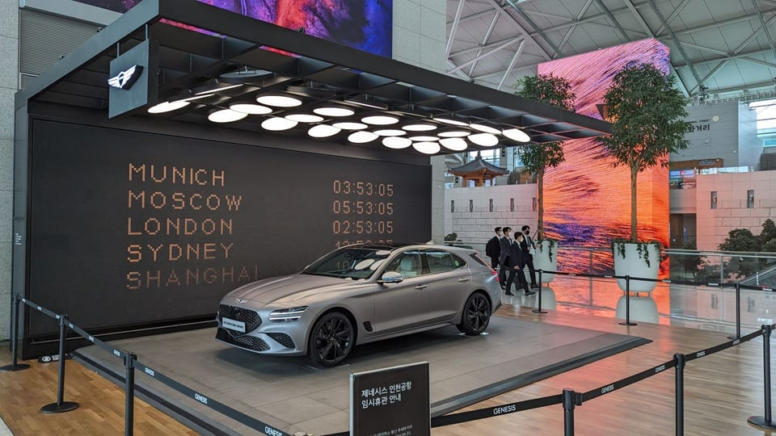
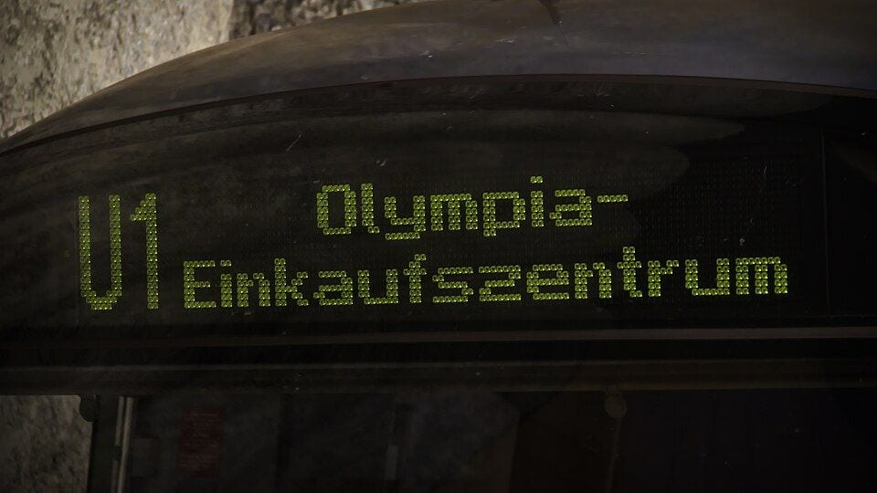
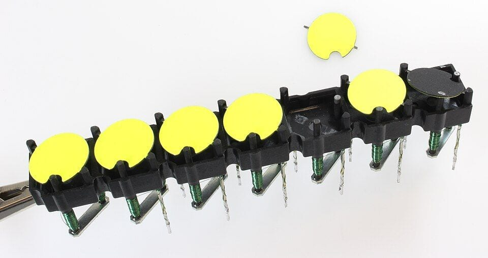
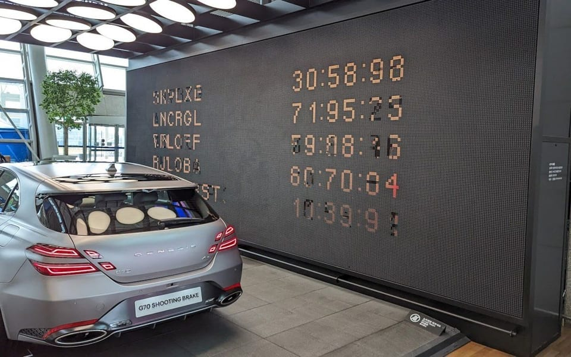
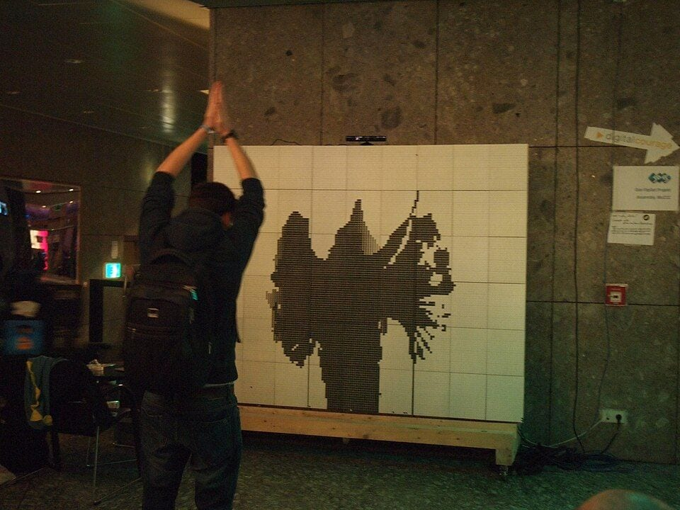
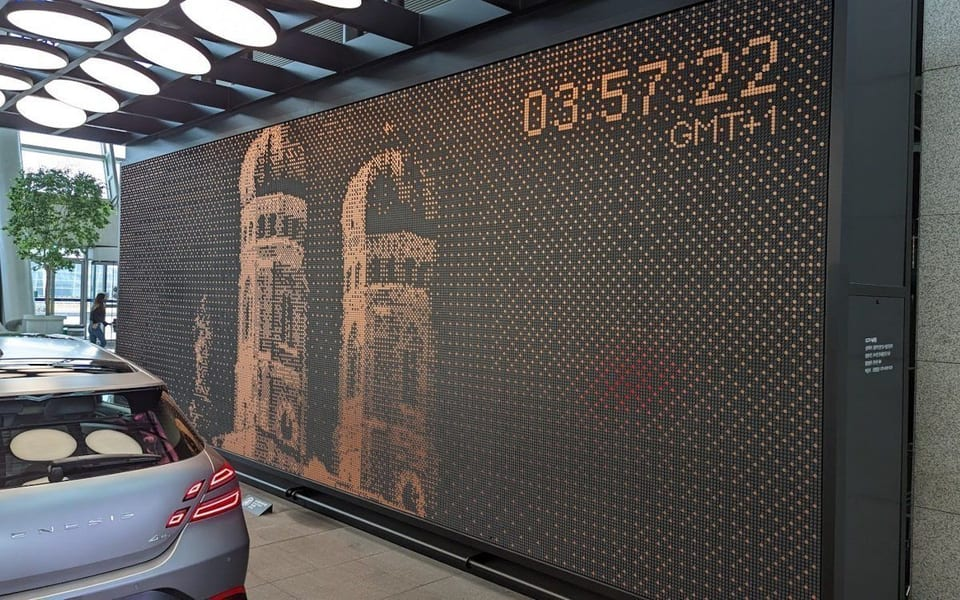

import FlipDot from '../../../components/flipdot/FlipDot.astro';

[쓸데없는 걸 만들어 올리는 시리즈](/posts/useless-ui/)의 첫 번째입니다. 플립닷(flip-dot) 디스플레이를 브라우저에 만들었습니다.

인천공항 1터미널 3층에는 제네시스 전시존이 있었고, 그 벽이 플립닷이었습니다. 2020년 4월에 [디스트릭트](https://kr.dstrict.com/COMMERCIAL/?bmode=view&idx=6755660)가 만든 것으로, 옆에는 세계 도시의 시각을 번갈아 보여 주는 바닥부터 천장까지의 플립닷 벽도 있었다고 합니다([invidis 기사](https://invidis.com/news/2022/11/genesis-nostalgia-in-the-most-modern-form/)). 영상으로만 봐도 수천 개의 원판이 한꺼번에 뒤집히면서 나는 "드르륵" 소리가 좋았습니다. 그걸 브라우저에 넣어 봤습니다.


<p class="caption">인천공항 1터미널 제네시스 전시존의 플립닷 벽. 세계 도시의 시각을 번갈아 보여 줍니다.<br />출처: <a href="https://invidis.com/news/2022/11/genesis-nostalgia-in-the-most-modern-form/">invidis</a></p>

## 바로 눌러 보기

<FlipDot locale="ko" />

- 처음에는 **시계** 모드로 세계 도시 시각이 돕니다. 콜론이 1초마다 깜빡이며 조용히 딸깍거립니다.
- **소리** 버튼이나 아무 버튼이나 한 번 누르면 소리가 켜지면서 보드 전체가 한 번 뒤집힙니다. 이게 핵심입니다. 꼭 소리를 켜고 보세요.
- **텍스트**는 영문 대문자와 숫자가 도트 폰트로 나옵니다. 7글자 이하면 크게 나옵니다. `*`는 하트입니다. 한글도 되긴 하는데 거칩니다.
- **IONIQ 5 N**은 제가 좋아하는 차입니다. 들어와서 멈추고 비상등을 깜빡이고 다시 달려 나갑니다.
- **그리기**는 드래그하면 칠해지고 노란 점을 누르고 드래그하면 지워집니다.
- **카메라**를 켜면 웹캠 영상이 1비트로 바뀌어 올라갑니다. 영상은 브라우저 안에서만 처리되고 어디로도 보내지 않습니다. 임계값과 디더링을 바꿔 보면 차이가 바로 보입니다.

## 플립닷은 어떻게 뒤집히나

플립닷은 1970년대부터 버스 행선지 표시판, 역의 안내판, 고속도로 전광판에 쓰인 디스플레이입니다. 지금은 대부분 LED로 바뀌었지만 이 소리와 질감 때문에 설치 미술이나 전시 공간에서 다시 쓰입니다.


<p class="caption">뮌헨 지하철 C1 열차의 플립닷 행선판. 아직 현역입니다.<br />출처: <a href="https://commons.wikimedia.org/wiki/File:C1_6609_Flipdot_-_U1_Olympia-Einkaufszentrum.jpg">Wikimedia Commons</a>, Foobian, CC0</p>

구조는 단순합니다. 점 하나는 한 면이 형광 노랑, 반대 면이 검정으로 칠해진 작은 원판이고 원판 안에 영구자석이 들어 있습니다. 원판은 축에 걸려 있어서 돌 수 있고 그 아래에 코일을 감은 전자석 심이 있습니다. 코일에 짧은 전류 펄스를 한 방향으로 흘리면 심이 한쪽 극성으로 자화되고 원판의 영구자석이 거기에 맞춰 돌면서 노란 면이 앞으로 옵니다. 반대 방향 펄스를 주면 검은 면이 옵니다.

심의 재질이 중요합니다. 전류를 끊어도 자성이 남는 재질이라 원판은 마지막 펄스 방향으로 계속 붙어 있습니다. 전원이 끊어져도 글자가 그대로 남아 있는 **쌍안정**(bistable) 디스플레이이고 전력은 오직 뒤집는 순간에만 씁니다. 소리도 그때만 납니다. 원판이 돌아서 멈춤턱에 부딪히는 소리가 바로 그 "딸깍"이고 수천 개가 몇백 밀리초 사이에 연달아 부딪히면 "드르륵"이 됩니다.


<p class="caption">Brose 1세대 플립닷 모듈. 원판 아래 녹색으로 감긴 것이 코일이고 오른쪽 끝 하나가 검은 면으로 뒤집혀 있습니다. 위에 빼 둔 원판에 축이 걸리는 홈이 보입니다.<br />출처: <a href="https://commons.wikimedia.org/wiki/File:Flipdotrow.jpg">Wikimedia Commons</a>, MakeMagazinDE, CC BY-SA 4.0</p>

컨트롤러는 모든 점을 동시에 뒤집지 않습니다. 코일 하나에 흘리는 펄스가 수백 마이크로초에서 수 밀리초 정도 걸리고 행과 열의 드라이버를 공유하는 매트릭스 구조라 한 번에 한 점, 잘해도 한 줄씩 순서대로 처리합니다. 그래서 화면 전체가 바뀔 때 위에서 아래로 쓸려 내려가는 모양이 나옵니다. 이 제약이 플립닷을 플립닷처럼 보이게 하는 요소라 시뮬레이션에서도 그대로 흉내 냈습니다.


<p class="caption">같은 벽이 다음 화면으로 넘어가는 순간. 줄마다 뒤집히는 타이밍이 달라 글자가 잠깐 깨져 보입니다. 이게 흉내 내고 싶었던 장면입니다.<br />출처: <a href="https://invidis.com/news/2022/11/genesis-nostalgia-in-the-most-modern-form/">invidis</a></p>

## 어떻게 만들었나

점 84×28개, 2,352개짜리 보드입니다. 전부 바닐라 TypeScript이고 라이브러리는 없습니다. 코드는 [저장소](https://github.com/GUMBOKIM/gumbo-blog/tree/main/src/components/flipdot)에 있습니다.

### 점 2,352개를 그리기

점마다 DOM 요소를 만들면 안 됩니다. 2천 개 요소에 매 프레임 스타일을 바꾸는 건 레이아웃과 페인트 비용이 너무 큽니다. Canvas 2D 하나에 `ellipse()`로 그리면 1만 개 정도까지는 60fps가 나옵니다. WebGL까지 갈 필요가 없었습니다.

뒤집히는 애니메이션은 원판이 가로축을 중심으로 위아래로 돈다고 보고 보이는 세로폭을 각도의 코사인으로 줄였다 늘립니다. 절반을 지나는 순간, 즉 원판이 정확히 옆으로 누웠을 때 색을 바꿉니다. 인천공항 벽도 이렇게 위아래로 뒤집혔습니다.

```ts
// p: 0에서 시작해 80ms 뒤에 1이 되는 진행도
const p = (now - flipAt[i]) / FLIP_MS;
let ry = radius;
let on = side[i] === 1;
if (p < 1) {
	ry = Math.max(radius * Math.abs(Math.cos(p * Math.PI)), 0.4);
	if (p < 0.5) on = !on; // 절반 전까지는 이전 면이 보인다
}
ctx.ellipse(cx, cy, radius, ry, 0, 0, TAU);
```

점의 상태는 `Uint8Array` 세 개로 둡니다. 지금 보이는 면(`side`), 컨트롤러가 원하는 면(`target`), 각 점이 마지막으로 뒤집기 시작한 시각(`flipAt`)입니다. 그리고 움직이는 점이 하나도 없으면 다시 그리지 않습니다. 시계 모드에서 가만히 있을 때 CPU를 거의 안 쓰는 이유입니다.

### 진짜 같은 느낌은 제약에서 나온다

처음에는 `target`이 바뀌면 다른 점을 전부 동시에 뒤집었습니다. 그러면 화면이 한 번에 "탁" 바뀌는데, 이상하게 가짜처럼 보였습니다. 실제 하드웨어의 스캔을 넣고 나서야 플립닷다워졌습니다.

시뮬레이션의 컨트롤러는 매 프레임마다 시간 예산을 받아서 행을 위에서 아래로 훑습니다. 행 하나를 지나는 데 기본 3ms가 들고 그 행에서 실제로 뒤집는 점 하나마다 0.35ms가 더 듭니다.

```ts
budget += dt; // 이번 프레임에 흐른 시간
while (budget > 0) {
	let flipped = 0;
	for (const i of rowCells(scanRow)) {
		if (target[i] !== side[i]) {
			side[i] = target[i];
			flipAt[i] = now + consumed; // 뒤 행은 조금 늦게 뒤집히기 시작한다
			flipped++;
		}
	}
	const cost = ROW_MS + DOT_MS * flipped; // 3ms + 0.35ms × 뒤집은 점
	budget -= cost;
	consumed += cost;
	scanRow = (scanRow + 1) % ROWS;
}
```

이렇게 하면 변화가 없을 때는 보드 한 바퀴에 84ms가 걸려서 초당 12번쯤 훑고, 보드 전체가 반전될 때는 한 바퀴에 0.9초가 걸립니다. 바쁜 행은 느리게 지나가므로 큼직한 변화는 눈에 보이게 쓸려 내려오고 콜론 깜빡임 같은 작은 변화는 거의 즉시 반영됩니다. 숫자 두 개로 이 느낌이 다 나옵니다.

### 딸깍 소리

소리는 Web Audio로 합성합니다. 샘플 파일 없이 노이즈 한 조각과 필터로 만들었습니다. 딸깍 하나는 두 소리의 합입니다.

- 50ms짜리 백색 노이즈를 1.8~4.2kHz 사이의 무작위 주파수로 밴드패스 걸고 22ms 안에 사라지게 한 것. 원판이 돌면서 긁히는 소리입니다.
- 190Hz에서 90Hz로 급히 떨어지는 사인파를 18ms만 낸 것. 원판이 멈춤턱에 부딪히는 "툭"입니다.

주파수를 매번 조금씩 다르게 하는 게 중요합니다. 같은 소리를 반복하면 기계음이 아니라 효과음처럼 들립니다.

소리를 내는 시점은 위의 스캔 루프와 묶여 있습니다. 어떤 행에서 점이 뒤집혔으면 그 행의 `consumed` 시각에 맞춰 딸깍을 예약합니다. 뒤집힌 점이 많을수록 그 행에 딸깍을 더 많이(최대 4개), 더 크게 넣습니다. 그래서 보드 전체가 뒤집힐 때는 행이 순서대로 울려서 "드르륵"이 되고 콜론 하나 깜빡일 때는 "딸깍" 한 번만 납니다. 소리를 뒤집히는 점 수에 비례시킨 것뿐인데 이게 있고 없고의 차이가 가장 컸습니다.

```ts
row(flipped: number, offsetMs: number) {
	const clicks = Math.min(1 + Math.floor(flipped / 10), 4);
	const strength = 0.1 + 0.2 * Math.min(1, flipped / 12);
	const base = ctx.currentTime + 0.012 + offsetMs / 1000;
	for (let i = 0; i < clicks; i++) click(base + i * 0.0015 + Math.random() * 0.002, strength);
}
```

브라우저는 사용자가 뭔가 누르기 전에는 소리를 못 내게 막습니다. 그래서 `AudioContext`는 위젯 안에서 첫 클릭이 일어날 때 만들고 그 순간 보드 전체를 한 번 노랗게 뒤집었다 되돌립니다. 진짜 표시판이 켜질 때 하는 테스트 패턴이기도 하고 소리가 켜졌다는 걸 바로 들려주는 방법이기도 합니다.

### 입력 다섯 가지

**시계**는 `Intl.DateTimeFormat`에 `timeZone`을 넘기면 끝입니다. 도시 12개를 3개씩 6초마다 돌립니다. 글자는 직접 그린 5×7 비트맵 폰트입니다. 한 줄에 14글자가 들어가고 한 글자는 5비트 숫자 7개로 표현합니다.

```ts
A: [0b01110, 0b10001, 0b10001, 0b11111, 0b10001, 0b10001, 0b10001],
```

**텍스트**도 같은 폰트를 씁니다. 단어 단위로 세 줄까지 줄바꿈하고 한 줄에 7글자 이하면 2배로 키웁니다. 한글은 5×7 비트맵 폰트가 없어서 다른 길로 갑니다. 보드와 같은 84×28 크기의 캔버스에 시스템 폰트로 글자를 찍고 픽셀을 꺼내 1비트로 자릅니다. 거칠지만 빈 보드보다는 낫습니다.

**그리기**는 포인터 이벤트로 셀 좌표를 구해 `target`을 직접 바꿉니다. 처음 누른 점이 노랑이면 그 스트로크는 지우기가 됩니다. 터치는 마우스보다 굵게 칠하고 포인터가 빨리 움직여 끊기지 않게 이전 위치와 선형 보간합니다.

**카메라**가 제일 손이 많이 갔습니다. `getUserMedia`로 받은 영상을 84×28 크기의 보이지 않는 캔버스에 중앙만 잘라 거울처럼 뒤집어 그리고 `getImageData`로 픽셀을 꺼내 밝기로 바꿉니다. 그다음 두 단계가 더 있습니다.

1. 밝기의 5~95 백분위를 0~255로 늘립니다(auto levels). 어두운 방에서도 얼굴이 나옵니다.
2. 이전 프레임과 55:45로 섞습니다. 웹캠의 센서 노이즈가 그대로 들어가면 경계에 있는 점들이 매 프레임 뒤집히면서 보드가 쉴 새 없이 떨립니다. 약간의 시간 평활로 이게 잡힙니다.


<p class="caption">2013년 30C3 행사장의 플립닷 벽. 카메라로 찍은 사람의 실루엣을 그대로 띄웁니다. 카메라 모드가 하려는 게 이겁니다.<br />출처: <a href="https://commons.wikimedia.org/wiki/File:30C3_Flipdot_1.jpg">Wikimedia Commons</a>, Ordercrazy, CC0</p>

그 결과를 1비트로 바꾸는 방법이 두 가지인데, 그게 다음 이야기입니다.

**IONIQ 5 N**은 원래 계획에 없었는데, 만들다 보니 픽셀 디자인인 차를 픽셀 보드에 안 넣을 수가 없었습니다. 옆모습은 Claude에게 58×17 도트로 찍어 달라고 했고 바퀴는 그림에서 빼고 따로 그립니다. 바퀴살 세 개의 각도를 굴러간 거리를 반지름으로 나눈 만큼 돌리면 실제로 구르는 것처럼 보입니다. 차가 가운데 서면 픽셀 램프 자리를 노랑으로 채워 비상등처럼 깜빡입니다.

### 임계값과 디더링

회색 사진을 노랑/검정 둘로만 그려야 합니다. 가장 쉬운 방법은 128보다 밝으면 노랑, 아니면 검정으로 자르는 임계값(threshold)입니다. 결과는 아래 왼쪽처럼 됩니다. 그라데이션은 한 줄의 경계로 뭉개지고 구의 입체감이 사라집니다.

<FlipDot locale="ko" variant="compare" />

오른쪽은 Floyd–Steinberg 디더링입니다. 아이디어는 반올림할 때 생긴 오차를 버리지 않고 아직 처리하지 않은 이웃 픽셀에 떠넘기는 겁니다. 밝기 100짜리 픽셀을 검정(0)으로 결정했으면 100만큼 "빚"이 생기고 그 빚을 오른쪽에 7/16, 왼쪽 아래 3/16, 아래 5/16, 오른쪽 아래 1/16로 나눠 더합니다. 그러면 이웃은 그만큼 밝아져서 노랑이 될 확률이 올라가고 결과적으로 어떤 영역의 노란 점 비율이 원래 밝기와 같아집니다. 눈이 점을 뭉개서 보면 회색으로 읽힙니다.

```ts
for (let y = 0; y < rows; y++) {
	for (let x = 0; x < cols; x++) {
		const i = y * cols + x;
		const bit = buf[i] >= 128 ? 1 : 0;
		out[i] = bit;
		const err = buf[i] - (bit ? 255 : 0);
		if (x + 1 < cols) buf[i + 1] += (err * 7) / 16;
		if (y + 1 < rows) {
			if (x > 0) buf[i + cols - 1] += (err * 3) / 16;
			buf[i + cols] += (err * 5) / 16;
			if (x + 1 < cols) buf[i + cols + 1] += (err * 1) / 16;
		}
	}
}
```

1976년에 나온 알고리즘이고 코드는 열 줄입니다. 카메라 모드에서 디더링을 켜면 얼굴의 음영이 나오는 대신 점이 훨씬 많이 뒤집혀서 소리도 훨씬 커집니다. 실제 플립닷 벽에서 디더링을 쓰면 왜 그렇게 시끄러운지도 이걸로 설명됩니다.


<p class="caption">같은 벽이 도시의 건물 사진을 디더링해서 띄운 모습.<br />출처: <a href="https://invidis.com/news/2022/11/genesis-nostalgia-in-the-most-modern-form/">invidis</a></p>

### 블로그에 끼우기

이 블로그는 Astro이고 페이지 전환에 `ClientRouter`를 씁니다. 그래서 스크립트 모듈은 처음 한 번만 로드되고 페이지를 넘겨도 다시 실행되지 않습니다. 초기화는 `astro:page-load`에서 하고 `astro:before-swap`에서 카메라를 끄고 애니메이션 루프를 멈춰야 합니다. 안 그러면 다른 글로 넘어간 뒤에도 웹캠 불이 켜져 있습니다.

```ts
document.addEventListener('astro:page-load', mountAll);
document.addEventListener('astro:before-swap', unmountAll);
```

그리고 `IntersectionObserver`로 보드가 화면에 보일 때만 `requestAnimationFrame`을 돕니다. 글을 읽으러 아래로 내려갔는데 위에서 시계가 계속 딸깍거리면 그것도 꽤 거슬립니다.

## 마무리

플립닷 시뮬레이션에서 배운 건 두 가지입니다. 첫째, 진짜 같은 느낌은 제약에서 나왔습니다. 모든 점을 동시에 뒤집을 수 있는데도 굳이 한 줄씩 뒤집는 게 핵심이었습니다. 둘째, 소리가 효과의 절반을 차지합니다. 뒤집히는 점 수에 비례하는 소리를 넣기 전과 후는 다른 물건이었습니다.

다음 글도 쓸데없는 걸 만들 예정입니다.
