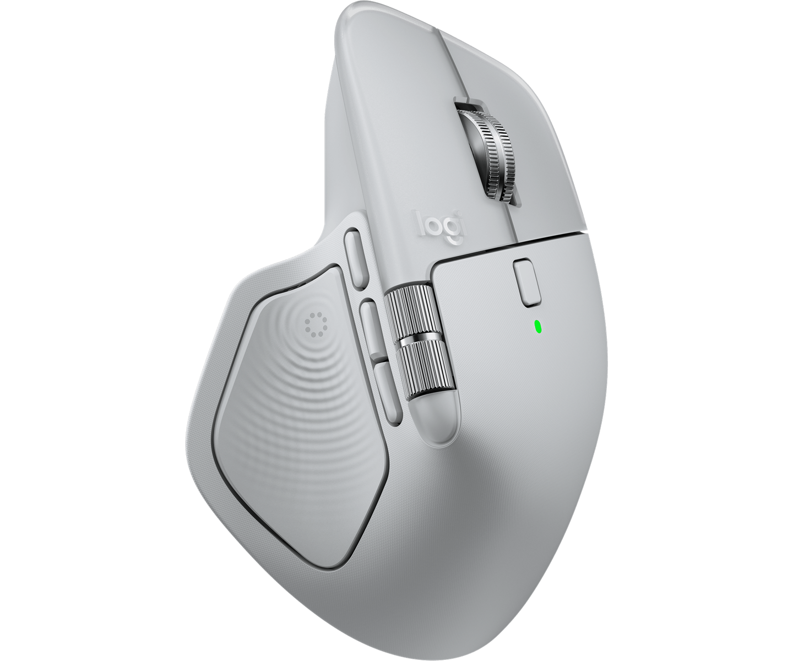

import flow from './assets/flow.svg?url';

요즘은 Claude Code한테 일을 맡겨 두고 다른 창에서 딴 일을 자주 합니다. 문제는 작업이 언제 끝났는지 모른다는 겁니다. 끝났나 싶어서 터미널을 열어 보면 아직 돌고 있고, 한참 잊고 있다가 열어 보면 진작 끝나 있습니다.

마침 쓰고 있던 MX Master 4에 진동 기능이 있어서, 작업이 끝날 때 마우스가 톡 떨려 주면 화면을 안 봐도 알 수 있겠다 싶었습니다.


<p class="caption">로지텍 MX Master 4. 엄지가 닿는 물결무늬 부분이 진동하는 햅틱 센스 패널입니다.<br />출처: <a href="https://www.logitech.com/ko-kr/products/mice/mx-master-4.html">Logitech</a></p>

그렇게 만든 게 [MacNotify](https://marketplace.logi.com/plugin/MacNotify/en)입니다. Mac에 알림 배너가 뜨면 마우스가 진동하고, 앱마다 진동 패턴을 다르게 정할 수 있습니다. 로지텍 마켓플레이스에 올라가 있고, 코드는 [GitHub](https://github.com/GUMBOKIM/Logitech-plugin-MacNotify)에 있습니다.

이 플러그인은 코드를 직접 짜지 않고 처음부터 끝까지 바이브 코딩으로 만들었습니다. 다만 대뜸 "이런 거 만들어 줘"라고 시키지 않고, 되는지부터 조사한 다음 spec 문서를 써서 넘겼습니다. 그래서 이 글은 AI와 어떤 대화를 했는지보다, 코드를 맡기기 전에 제가 직접 알아보고 정한 것들에 대한 이야기입니다.

## 시키기 전에 되는지부터 알아봤다

제일 먼저 한 건 "이게 정말 되나"를 확인하는 일이었습니다. 만들고 싶은 걸 쪼개 보니 질문이 세 개 나왔습니다.

1. 로지텍 마우스를 진동시키려면 어떻게 해야 하나?
2. Mac에서 Claude Code 작업이 끝난 걸 어떻게 알 수 있나?
3. Mac에서 알림이 뜨는 순간을 어떻게 잡나?

셋 중 하나라도 막히면 아예 못 만드는 기능이라, 구현을 시키기 전에 각각 방법부터 찾아봤습니다.

### 마우스 진동은 Logi Actions SDK로

로지텍은 Options+ 앱에 플러그인을 붙일 수 있는 [Logi Actions SDK](https://logitech.github.io/actions-sdk-docs/)를 제공합니다. 찾아본 것 중에서는 이게 그나마 제일 편했습니다. 플러그인이 이벤트를 하나 보내면, 그 이벤트에 연결해 둔 진동 패턴이 마우스에서 재생됩니다.

진동 패턴은 15가지가 들어 있습니다. `happy_alert`, `knock`, `jingle`, `firework` 같은 것들입니다. 패턴마다 이벤트를 하나씩 등록해 두면, 어떤 이벤트를 보내느냐로 패턴을 바꿀 수 있습니다.

### 알림만 잡으면 된다

Claude Code는 작업이 끝나면 Mac 알림을 띄울 수 있습니다. 그러면 Claude Code를 따로 감시할 필요 없이 알림만 잡으면 됩니다.

여기서 욕심이 좀 생겼습니다. 카톡도 알림이 오고 슬랙도 알림이 옵니다. 알림을 통째로 잡으면 메시지가 와도 마우스가 떨리게 할 수 있습니다. 다만 다 똑같이 떨리면 뭐가 온 건지 모르니까, 앱마다 패턴을 다르게 줄 수 있게 했습니다. 슬랙은 `knock`, 캘린더는 `jingle` 하는 식입니다.

### 알림 감지는 여러 방법을 직접 돌려 봤다

세 번째가 제일 골치였습니다. macOS에는 다른 앱의 알림을 받아 볼 수 있는 공식 API가 없습니다. 결국 알림이 어딘가에 남기는 흔적을 읽어야 하는데, 그걸 어디서 읽을지가 문제였습니다. 이것저것 직접 돌려 보고 마지막까지 남은 건 두 가지였습니다.

| | 알림 센터 DB 읽기 | 알림 데몬 로그 읽기 |
|---|---|---|
| 방식 | 알림 센터가 쓰는 SQLite DB를 1초마다 확인 | 알림을 띄우는 `usernoted`의 로그를 실시간으로 읽음 |
| 지연 | 약 5초 | 약 100ms |
| 권한 | 전체 디스크 접근 필요 | 필요 없음 |
| 방해 금지 모드 | 따로 처리해야 함 | 알아서 지켜짐 |

먼저 떠오르는 건 알림 기록이 쌓이는 DB를 보는 방법입니다. 그런데 써 보니 느렸습니다. macOS가 기록을 바로바로 쓰지 않고 몰아서 쓰는지, 배너가 뜨고 5초쯤 지나서야 DB에 들어왔습니다. 알림을 이미 다 읽었는데 그제야 마우스가 떨리면 의미가 없습니다. 이 DB를 읽으려면 전체 디스크 접근 권한도 받아야 합니다. 마우스 좀 떨리게 하자고 그 권한을 달라고 하기는 좀 그랬습니다.

그래서 로그를 읽기로 했습니다. macOS의 `log stream`으로 알림 데몬의 로그를 실시간으로 보고 있으면, 배너가 뜰 때 이런 줄이 찍힙니다.

```
Presenting <NotificationRecord app:"com.tinyspeck.slackmacgap" ...
```

이 줄만 걸러 보면 됩니다.

```
log stream --style compact --predicate 'subsystem == "com.apple.unc" AND eventMessage CONTAINS "Presenting <NotificationRecord"'
```

`log stream`은 시작할 때 첫 줄에 필터 조건을 그대로 찍어 주는데, 그 안에도 `Presenting <NotificationRecord`가 들어 있습니다. 그래서 이 첫 줄은 따로 걸러야 합니다. 안 그러면 플러그인을 켜자마자 알림도 없는데 마우스가 한 번 떨립니다.

배너가 뜨고 100ms 정도면 잡히고, 이렇게 감지하는 데는 권한도 따로 필요 없습니다. 줄 안에 보낸 앱의 bundle id(`com.tinyspeck.slackmacgap`)가 들어 있어서 앱마다 패턴을 고르는 데 그대로 쓸 수 있습니다. 알림 내용은 보지 않습니다. 배너가 떴다는 것과 어느 앱인지만 씁니다.

이 방식으로 방해 금지 모드가 공짜로 해결된 것도 좋았습니다. `Presenting`은 배너가 실제로 화면에 뜰 때만 찍힙니다. 집중 모드나 방해 금지 모드라서 조용히 넘어간 알림은 이 줄을 안 남기니까, 아무것도 안 해도 그때는 마우스가 가만히 있습니다.

DB 읽기도 버리지는 않았습니다. 로그 스트림이 아예 안 켜지거나 몇 번을 다시 켜도 계속 꺼지면 DB 확인으로 넘어갑니다. 이때 Options+에 5초 늦어진다는 경고를 띄우고, 전체 디스크 접근 권한이 없어서 DB를 못 읽으면 권한을 달라는 오류를 띄웁니다.

### 그래서 이렇게 돌아간다

조사한 걸 합치면 전체 흐름은 이렇습니다.


앱이 알림을 보내면 `usernoted`가 배너를 띄우면서 로그를 한 줄 남깁니다. MacNotify는 그 줄을 보고 어느 앱인지 확인한 다음, 그 앱에 정해 둔 패턴의 이벤트를 보냅니다. 슬랙이면 `notif_knock` 같은 식입니다. 그러면 Logi Plugin Service가 그 이벤트를 `knock` 진동으로 바꿔서 마우스로 보냅니다.

## 조사한 걸 spec 문서로 넘겼다

구현은 조사가 다 끝나고 나서 맡겼습니다. 대화로 하나씩 시키지 않고, 조사한 내용을 요구사항 spec 문서(md) 하나로 정리해서 넘겼습니다.

SDK 이벤트로 진동을 내고, `usernoted` 로그로 알림을 잡고, 안 되면 DB 확인으로 넘어가고, 앱마다 패턴을 따로 둔다는 것까지 앞에서 확인한 내용은 다 문서에 적었습니다. 무엇을 어떻게 만들지 정해 둔 상태에서 구현만 맡긴 셈입니다.

그렇게 나온 플러그인은 Options+에서 마우스 버튼에 붙일 수 있는 동작 네 개로 쓰게 돼 있습니다.

| 동작 | 하는 일 |
|---|---|
| Haptic Pattern | 기본 진동 패턴 고르기. 고르는 동안 바로 진동으로 미리 느껴 볼 수 있습니다 |
| Per-App Haptic Pattern | 앱마다 패턴을 따로 정하거나 아예 끄기 |
| Notification Haptics On/Off | 알림 진동 전체를 켜고 끄기. 회의 들어갈 때 버튼 하나로 끄면 편합니다 |
| Test Haptic | 지금 패턴을 한 번 울려 보기 |

앱별 설정 목록에는 그동안 알림을 보낸 적 있는 앱이 뜹니다. 이 목록은 알림 센터 DB에서 가져와서, 전체 디스크 접근 권한을 줬을 때만 예전 앱까지 다 나옵니다. 권한이 없으면 플러그인을 켠 뒤로 알림을 보낸 앱부터 하나씩 쌓입니다.

## 진동은 직접 쥐어 봐야 안다

코드가 나온 다음에는 실제 기기로 테스트했습니다. 이건 AI한테 맡길 수가 없었습니다. 진동이 제대로 오는지는 제가 마우스를 쥐고 알림을 띄워 보면서 확인했습니다.

## 마켓플레이스 심사, 그리고 SDK 변경

테스트를 마치고 7월 중순에 v1.0을 마켓플레이스 심사에 냈습니다. 그런데 심사를 기다리는 사이에 로지텍 쪽이 바뀌었습니다. 플러그인을 돌리는 Logi Plugin Service가 6.4 버전부터 .NET 10으로 올라간 겁니다.

v1.0은 SDK의 `PluginApi.dll`을 패키지 안에 같이 넣어 두고 있었습니다. 서비스가 바뀌면서 이 dll이 옛날 버전이 돼 버렸고, 6.4 이상에서는 플러그인이 아예 안 뜰 수도 있었습니다. 심사에서도 이 dll을 빼라는 얘기를 들었습니다.

그래서 dll은 패키지에서 빼고 서비스에 들어 있는 걸 쓰게 했고, 대상 버전도 .NET 10으로 올렸습니다. 최소 지원 버전은 6.4로 적었습니다. 7월 16일에 v1.0.1로 다시 냈고, 지금 마켓플레이스에 있는 게 이 버전입니다.

솔직히 심사 과정은 좀 아쉬웠습니다. 로지텍 쪽과 한 번 주고받는 데 시간이 너무 오래 걸렸고, 등록이 됐다는 결과도 따로 알려 주지 않아서, 올라갔는지는 제가 직접 마켓플레이스에 들어가 보고 알았습니다.

## 개발자가 바이브 코딩을 해 보니

코드는 AI가 다 짰지만, 되는 방법을 찾아 직접 돌려 보고, 방식을 고르고, 실제 마우스를 쥐고 확인하는 일은 결국 제 몫이었습니다. 이 글의 대부분이 그 이야기인 것도 그래서입니다. 코드를 짜는 대신 그 과정에 시간을 쓴 셈입니다.

MX Master 4를 쓰고 계시면 [마켓플레이스](https://marketplace.logi.com/plugin/MacNotify/en)에서 받아 보세요. 버그나 바라는 기능은 [GitHub 이슈](https://github.com/GUMBOKIM/Logitech-plugin-MacNotify/issues)에 남겨 주시면 됩니다.
