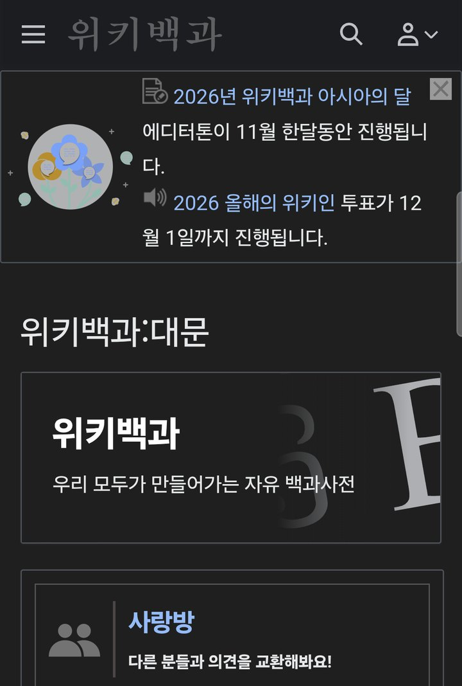

import DarkLab from '../../../components/samsungdark/DarkLab.astro';
import logo from './assets/samsung-internet-logo.png';


<p class="caption">Samsung Internet. Source: <a href="https://play.google.com/store/apps/details?id=com.sec.android.app.sbrowser">Google Play</a></p>

If you build web front ends, you have probably run into this at least once. You never made a dark mode, yet someone reports that the page shows up pitch black, but only on Galaxy phones. White backgrounds turn black and brand-colored buttons turn a muddy brown. On the same phone, Chrome looks fine.

The culprit is a Samsung Internet setting that forces dark mode on web content. It is on by default when the phone uses the dark theme, and the browser changes the colors whether or not the page supports dark mode. Here is Wikipedia's main page on the same phone.

<div class="gallery">
<div>


<p class="caption">Chrome</p>

</div>
<div>


<p class="caption">Samsung Internet</p>

</div>
</div>

Nothing I tried fixed it, so I changed direction and dug into two questions:

1. **At which stage** of drawing the page do the colors change?
2. **By what rules** do they change?

Measurements were taken on a Galaxy S25 (SM-S931N) with Samsung Internet 31.0.0.81 (based on Chromium 148), with the system dark theme and forced dark on and the eye comfort filter off.

## Where do the colors change?

### How I measured

With the phone connected over USB, Samsung Internet can be debugged remotely from a PC. I used that to open test pages, run JavaScript, and take screenshots.

The test page is a grid. Each cell has one color and one way of painting it (background, text, border, SVG…). I read the center pixel of every cell from the screenshot and compared it with the original color. 256 gray levels painted 11 ways makes 2,816 cells.

There was one trap. Samsung Internet saves screenshots in the Display P3 color space. Grays are unaffected but other colors shift, so I converted them to sRGB before comparing. A control painted on a canvas showed the conversion error was at most 4.

### Checking stage by stage

A browser builds the screen in five stages. For each one I first asked what trace it would leave if it changed the colors, then checked whether that trace was there.

<DarkLab locale="en" variant="pipeline" />

#### Stage 1, render tree: no

This stage reads HTML and CSS and settles the final style of every element. If the colors changed here, JavaScript would read the changed colors too.

A white background that looks black on screen still read as `rgb(255, 255, 255)` through `getComputedStyle`. While forced dark is on, the signals the page receives still say light mode.

| Setting | Screen | `prefers-color-scheme` | Page's dark CSS |
|---|---|---|---|
| Forced on + system dark | Forced dark | `light` | Not applied |
| Forced off + system dark | Normal | `dark` | Applied |
| Forced on + system light | Normal | `light` | Not relevant |

In the first row the screen is dark, yet the page believes it is in light mode. The colors are untouched until styles are settled.

#### Stage 2, layout: no

This stage works out where everything goes and how large it is. A feature that only changes colors has no reason to touch it, but I checked whether anything moved or resized.

All 2,816 cells of the test page were drawn exactly where and as large as they were placed. Overlaid on the same page in Chrome on the same phone, no element had moved.

#### Stage 3, paint: yes

This stage records draw commands for each element, such as "fill the background here in this color, then write this text on top". It knows whether it is drawing a background or text.

I painted the same `#808080` in different ways.

| `#808080` painted as | Value on screen |
|---|---|
| Background | 16 |
| Border | 77 |
| SVG shape | 153 |
| Text | 164 |

One input, four outputs. The color is changed at a point that knows what is being drawn, and that point is paint. The size rules later in this post, such as "boxes up to 20px" and "icons up to 90px", also need to know what is drawn and how large.

#### Stage 4, raster: no

This stage turns the recorded commands into actual pixels. If the colors were changed here without knowing what was drawn, the same gray would always become the same value.

But as the table in stage 3 shows, the same gray became different values for different targets. A background of 16 and a border of 77 are both plain rectangle fills, which cannot be told apart without knowing what is being drawn. Images behave the same way: one PNG file is darkened ×0.7 as an `` and ×0.5 as a CSS background. The browser is looking at how something is drawn, so the colors are most naturally settled before they reach raster.

The transparent icon rule later in this post does look at an image's pixels, though. Exactly when that check happens could not be told from measurements alone.

#### Stage 5, compositing: no

This stage combines the layers and sends them to the screen. A dark filter laid over the whole screen here would darken a canvas too.

I painted 0, 128, and 255 on a canvas, and they stayed 0, 128, and 255 on screen. At the very least, there is no filter laid over the whole screen at once.

#### Conclusion

What best explains the measurements is **paint**. Style resolution is already over by then, which is why the page's JavaScript only ever sees the original colors.

The detection experiment later on points the same way. An SVG image drawn onto a canvas, not the screen, still comes out converted. That path skips the screen's raster and compositing, so the colors must change at the moment of drawing.

Chromium, which Samsung Internet is built on, has a forced dark feature of its own, and its public source shows the same structure. The links point to the Chromium 143 source.

1. At the style stage, [`SetUsedColorScheme`](https://github.com/chromium/chromium/blob/143.0.7499.192/third_party/blink/renderer/core/style/computed_style.cc#L3231) leaves the colors alone and only marks the element as a forced dark target.
2. At the paint stage, the code that draws backgrounds, text, and borders passes its role (`kBackground`, `kForeground`, `kBorder`, and so on) in an [`AutoDarkMode`](https://github.com/chromium/chromium/blob/143.0.7499.192/third_party/blink/renderer/core/paint/paint_auto_dark_mode.h).
3. [`GraphicsContext`](https://github.com/chromium/chromium/blob/143.0.7499.192/third_party/blink/renderer/platform/graphics/graphics_context.cc#L93) converts the color right before drawing.

That fits the measurements well. The conversion formula, however, differs from Chromium's, as compared further down.

## What are the rules?

### 1. Color conversion

I started by painting all 256 gray levels from black to white as each target. Below, the RGB color space is drawn as a cube for each target, side by side. Seen along the axis from white to black, a cube looks like a regular hexagon. Drag to turn all the cubes together, and click a color to see what each target turns it into. The strip underneath shows the 256 grays measured on the phone.

<DarkLab locale="en" variant="cube" />

| Painted as | `#000000` | `#808080` | `#FFFFFF` |
|---|---|---|---|
| Background | 1 | 16 | 31 |
| `input`, `textarea` background | 17 | 29 | 42 |
| `button`, `select` background | 38 | 56 | 74 |
| Gradient | 5 | 18 | 31 |
| Outline | 36 | 43 | 51 |
| Border | 69 | 77 | 84 |
| Shadow | 71 | 78 | 84 |
| SVG | 128 | 153 | 179 |
| Text | 255 | 164 | 255 |
| `` bitmap | 0 | 90 | 178 |
| CSS background image | 0 | 64 | 128 |
| canvas | 0 | 128 | 255 |

Three things stood out.

**Every background has its luma squeezed into 1–31.** That is why white and light gray become almost indistinguishable, and why you cannot compensate by choosing colors in advance. The background that covers the whole page is darker still. On `<html>`, or on `<body>` when `<html>` has no background, white becomes 20. A page with no background at all is painted 1.

**Text breaks between 216 and 217.** Up to 216 the luma is inverted and the result is 102; from 217 it is not inverted and the result is 228. Inputs one apart come out 126 apart.

**Small boxes up to 20px have their backgrounds inverted like text.** When both sides are 20px or less, a `#808080` background becomes 164; if either side is 21px or more, it becomes 16. It looks meant to treat small icons and color chips like text.

With the numbers laid out, it looked like there had to be a formula. Daniel Aleksandersen's 2020 [analysis of Samsung Internet 11](https://www.ctrl.blog/entry/samsung-internet-night-mode/) has it. The color is converted to Y′CbCr (BT.601), and only the luma Y moves into a range that depends on the target. In the original article the conversion is skipped when luma is 85% or more, but on 31.0 a white background still became 31. To match the measurements, 0.85 has to decide only whether to invert; the formula below is that adjusted version.

```
m  = (invert && y < 0.85) ? 1 - y : y
y' = min + m × (max - min)
```

The text break between 216 and 217 comes from that `0.85`. The skeleton of the formula is the same as six years ago, and some of the ranges changed.

| Target | 2020 (11) | Measured (31.0) |
|---|---|---|
| Background | 0.03 – 0.12 | **0.004 – 0.12** |
| Whole-page background | 0.03 – 0.08 | **0.004 – 0.08** |
| `input`, `textarea` background | 0.15 – 0.29 | **0.067 – 0.165** |
| SVG | fixed 0.30 | **0.50 – 0.70** |
| `button`, `select` background | 0.15 – 0.29 | same |
| Gradient | 0.02 – 0.12 | same |
| Border | 0.27 – 0.33 | same |
| Outline | 0.14 – 0.20 | same |
| Shadow | 0.28 – 0.33 | same |
| Text (inverted) | 0.29 – 1.00 | same |

Values computed with the new ranges matched all 2,816 gray measurements (11 targets × 256 levels) within ±1. Of 432 cells painting 72 chromatic colors as backgrounds, buttons, text, borders, gradients, and SVG, 431 were within 3 per channel.

This also explains the brown button. Moving only the luma while keeping the chroma (Cb, Cr) is the same as adding one value to all three RGB channels. Painting `#FEE500` as a background goes like this:

```
Original luma  Y  = 0.299×254 + 0.587×229 + 0.114×0 = 210.4
New luma       Y' = (0.004 + 0.825 × 0.116) × 255   =  25.4
Offset            = 25.4 - 210.4                    = -185.0

R 254 - 185 = 69
G 229 - 185 = 44
B   0 - 185 = 0 (clipped at 0)
```

The measured value is exactly `69, 44, 0`. Yellow with its brightness pushed way down is brown. Channels that drop below 0, like B here, are clipped, so the color shifts a little and the real luma of the result is about 46 rather than the target 25. Orange `#FF5714` loses G as well and becomes a dark red `142, 0, 0`.

### 2. Conversion by tag

I wondered whether semantic tags get treated differently, so I put the same colors on 27 tags. They fell into three groups.

| Background | 23 ordinary tags | `input`, `textarea` | `button`, `select` |
|---|---|---|---|
| `#000000` | 1, 1, 1 | 17, 17, 17 | 38, 38, 38 |
| `#808080` | 16, 16, 16 | 29, 29, 29 | 56, 56, 56 |
| `#FFFFFF` | 31, 31, 31 | 42, 42, 42 | 74, 74, 74 |
| `#FEE500` | 69, 44, 0 | 81, 56, 0 | 111, 86, 1 |
| `#FF5714` | 142, 0, 0 | 155, 0, 0 | 182, 13, 1 |
| `#1A73E8` | 0, 26, 143 | 0, 40, 157 | 0, 66, 183 |

The ordinary tags are `div`, `p`, `span`, `a`, `h1`, `section`, `article`, `header`, `nav`, `footer`, `main`, `aside`, `ul`, `li`, `table`, `label`, `mark`, `code`, `pre`, `blockquote`, `fieldset`, `details`, and `summary`. An `article` gives exactly the same values as a `div`. Only form controls are treated separately, so a button built from a `div` and a `button` tag come out in different colors even with the same yellow.

Text colors were the same on every tag.

| Text color | Result |
|---|---|
| `#000000` | 255, 255, 255 |
| `#808080` | 164, 164, 164 |
| `#FFFFFF` | 255, 255, 255 |
| `#FEE500` | 149, 124, 0 |
| `#FF5714` | 255, 120, 53 |
| `#1A73E8` | 107, 196, 255 |

### 3. Images and SVG

PNG, JPG, and WebP behaved the same. What matters is how the image is placed.

| Placed as | `#000000` | `#808080` | `#FFFFFF` | Rule |
|---|---|---|---|---|
| `` PNG, JPG, WebP | 0 | 90 | 178 | Every channel × about 0.7 |
| CSS `background-image` bitmap | 0 | 64 | 128 | Every channel × about 0.5 |
| `` SVG, inline `<svg>` | 128 | 153 | 179 | Luma moved to 0.50–0.70 |
| `<canvas>` | 0 | 128 | 255 | Unchanged |

The ×0.7 for `` was the same at 24px and 112px, and the ×0.5 for CSS backgrounds was the same for repeat, stretch, and `cover`. Real photos were not measured.

Unlike bitmaps, SVG brightens black up to 128. Vectors are shapes the browser draws itself, so they go through the color conversion. Measuring at different sizes showed that the range depends not on the SVG as a whole but on **the size of each shape**.

| Shape size | `#000000` | `#808080` | `#FFFFFF` | Rule |
|---|---|---|---|---|
| Under 20px on both sides | **179** | 153 | 179 | Luma inverted, moved to 0.50–0.70 |
| Other shapes | 128 | 153 | 179 | Luma moved to 0.50–0.70 |
| `rect`, `circle`, `ellipse` with a side of 90px or more | **38** | 56 | 74 | 0.15–0.29, same as buttons |

A 19px shape was inverted and a 20px one was not. Unlike boxes, which are inverted up to 20px, SVG shapes do not include 20px. The large-shape rule applies only to `rect`, `circle`, and `ellipse`; the same square drawn as a `<path>` stayed at 128.

Transparent PNG icons have a rule of their own. A black icon is brightened to 115 up to 90px, and stays plain black from 91px.

| Icon color | Up to 90px | From 91px |
|---|---|---|
| Black | **115** | 0 |
| White | 178 | 178 |
| Blue `#1A73E8` | 21, 80, 162 | 21, 80, 162 |

Changing one condition at a time showed that an image counts as an icon only when all three hold:

- It is drawn at 90px or less on both sides. The file's own size does not matter.
- At most 79% of its pixels are opaque. Images with a solid backdrop do not count.
- Every visible pixel is dark. Grays must stay under a luma of about 0.5 and colors under about 0.29; a single light pixel makes it an ordinary image.

The thresholds are approximations narrowed down with test images that changed one condition at a time. An icon gets 115 added to every channel. It looks meant to keep small black icons from disappearing into the dark background.

### 4. Compared with Chromium's forced dark

Samsung Internet is based on Chromium, but its formula is different. I turned on the auto dark mode of desktop Chrome 157 (`--enable-features=WebContentsForceDark`) and measured the same pages.

| Item | Samsung Internet 31.0 | Chrome 157 |
|---|---|---|
| Color space | Y′CbCr | CIELAB |
| Text gray 102 | 183 | 163 |
| Text gray 204 | 110 | 204 (unchanged) |
| Background gray 153 | 19 | 153 (unchanged) |
| Background `#FEE500` | 69, 44, 0 | 62, 47, 0 |

Chromium checks a [brightness threshold](https://github.com/chromium/chromium/blob/143.0.7499.192/third_party/blink/renderer/platform/graphics/dark_mode_settings_builder.cc#L30) first. It inverts backgrounds only above 205 and text only below 150, leaving everything else alone. Samsung squeezes every background. Try any color here:

<DarkLab locale="en" variant="probe" />

The Chromium column is a port of the Blink code. I checked it against 91 combinations of role and color in Chrome 157, and all matched within 1 per channel.

### Putting the rules together

This is an ordinary browser imitating the rules found so far. Switch modes with the buttons on top, and tap an element to see how its colors changed.

<DarkLab locale="en" variant="lab" />

The yellow button turns brown, the card border becomes brighter than the background, and only the canvas chart stays white. "CSS invert" is the common `filter: invert(1) hue-rotate(180deg)`, which flips the photos as well and looks nothing like it. Open this post on a Galaxy with forced dark on and the demo shows the original instead; what you see then is the real Samsung Internet result.

## What can we do?

Nothing.

Here is what I tried. None of it worked.

- `<meta name="color-scheme" content="only light">` and CSS `color-scheme: only light`
- `forced-color-adjust: none`
- Separate CSS for `prefers-color-scheme: dark` (it reports `light` while forced dark is on, so it never applies)
- Using dark colors from the start (dark backgrounds get converted again)

In Samsung Internet 30.0, turning on `#enable-adaptive-force-dark` in `internet://flags` made it respect `color-scheme` (not rechecked on 31.0). It is off by default, though, so it does nothing for real users. Chrome turns forced dark off for `color-scheme: only light` alone; Samsung ignores it.

### But it can be detected

`prefers-color-scheme`, `forced-colors`, `getComputedStyle`, and the `Sec-CH-Prefers-Color-Scheme` header all failed to reveal forced dark. One thing worked: **draw a white SVG image onto a canvas and read the pixel back.** Below is a stripped-down version; the library returns a more detailed state.

```ts
const svg = '<svg xmlns="http://www.w3.org/2000/svg" width="1" height="1">'
  + '<rect width="1" height="1" fill="#fff"/></svg>';

export function detectForcedDark(): Promise<boolean> {
  if (!/SamsungBrowser/i.test(navigator.userAgent)) return Promise.resolve(false);
  return new Promise((resolve) => {
    const image = new Image();
    image.onload = () => {
      try {
        const canvas = document.createElement('canvas');
        canvas.width = canvas.height = 1;
        const context = canvas.getContext('2d');
        if (!context) return resolve(false);
        context.drawImage(image, 0, 0, 1, 1);
        resolve(context.getImageData(0, 0, 1, 1).data[0] < 250);
      } catch {
        resolve(false);
      }
    };
    image.onerror = () => resolve(false);
    image.src = 'data:image/svg+xml,' + encodeURIComponent(svg);
  });
}
```

You can check the browser you are using right now.

<DarkLab locale="en" variant="mine" />

Drawing each format onto a canvas and reading it back, only SVG changes.

| Original color (10px image) | SVG | PNG | JPG | WebP |
|---|---|---|---|---|
| White | **179** | 255 | 255 | 255 |
| Gray 128 | **153** | 128 | 128 | 128 |
| Black | **179** | 0 | 0 | 0 |

PNG, JPG, and WebP files already have fixed pixels, so reading them back from a canvas gives the original. An SVG is painted anew every time it is drawn, and the forced dark conversion in that paint ends up in the canvas. It is the same "colors change in paint" finding again. 179 is the top of the SVG luma range, 0.70 × 255. White is above 0.85, so it is not inverted and lands at the top; black is inverted because the shape in a 10px image is under 20px, and it lands at the top too.

In Chromium the value is 255, because canvas `drawImage` draws images with [default options that turn dark mode off](https://github.com/chromium/chromium/blob/143.0.7499.192/third_party/blink/renderer/modules/canvas/canvas2d/canvas_2d_recorder_context.cc#L2366).

Once detected, all you can do is tell the user. Menu (≡) → Light mode turns forced dark off, so the most you can do is show a note asking them to tap it if the page looks wrong. I could not test Samsung Internet 29 and earlier or the "web page brightness in dark mode" slider. I also did not measure whether a real phone with forced dark off gives 255. A Samsung update could break the detection. Even then the note simply does not appear; the page does not get any worse.

In the end, the one thing in your hands is not to rely on color alone to carry meaning. Brand colors will change anyway. Buttons have to be recognizable by their text and shape.

## What I built

If it cannot be stopped, you should at least be able to see it without a Galaxy phone, so I built two things from the rules above. They all live in one repository.

**Repository: [github.com/GUMBOKIM/samsung-forced-dark-mode](https://github.com/GUMBOKIM/samsung-forced-dark-mode)**

1. **The library [samsung-forced-dark-mode](https://www.npmjs.com/package/samsung-forced-dark-mode)**: detects forced dark, and makes a page in an ordinary browser look like Samsung Internet. Install it with `npm install samsung-forced-dark-mode`; TypeScript is supported.
2. **The Chrome extension [Forced Dark Preview for Samsung Internet](https://chromewebstore.google.com/detail/forced-dark-preview-for-s/oehfkkpeilbfcfdaoehhmmicdnmpahhf)**: clicking the toolbar button makes the current page look like Samsung Internet.

I compared Samsung Internet on the Galaxy with Chrome running the library, pixel by pixel. A pixel matched when every channel was within 10.

| Compared | Match |
|---|---|
| 285 test cells combining element types and colors | 277 cells (97.2%) |
| 13 article and product pages, including BBC, CNN, Naver News, and Amazon | 97.2% on average, lowest 78.3% |

The article pages were frozen, with their images and CSS copied, so that ads and banners could not change between captures. That leaves out script behavior, iframes, video, and canvas, and live sites may match less. Chrome's auto dark mode works differently, so it cannot preview what Samsung shows. Colors that change on `:hover` or `:focus` are not handled yet.

## References

- [Everything you need to know about Night mode in Samsung Internet](https://www.ctrl.blog/entry/samsung-internet-night-mode/), Daniel Aleksandersen
- [Samsung Internet's dark mode turned my orange buttons dark red](https://dev.to/burthcer/samsung-internets-dark-mode-turned-my-orange-buttons-dark-red-my-fix-is-only-partial-4f3k), Dev Bhamaria
- [Fighting Samsung's Force Dark Mode](https://matt.sibson.link/blog/samsung-dark-mode), Matt Sibson
- [Chromium Blink's dark_mode_filter.cc](https://github.com/chromium/chromium/blob/143.0.7499.192/third_party/blink/renderer/platform/graphics/dark_mode_filter.cc)
