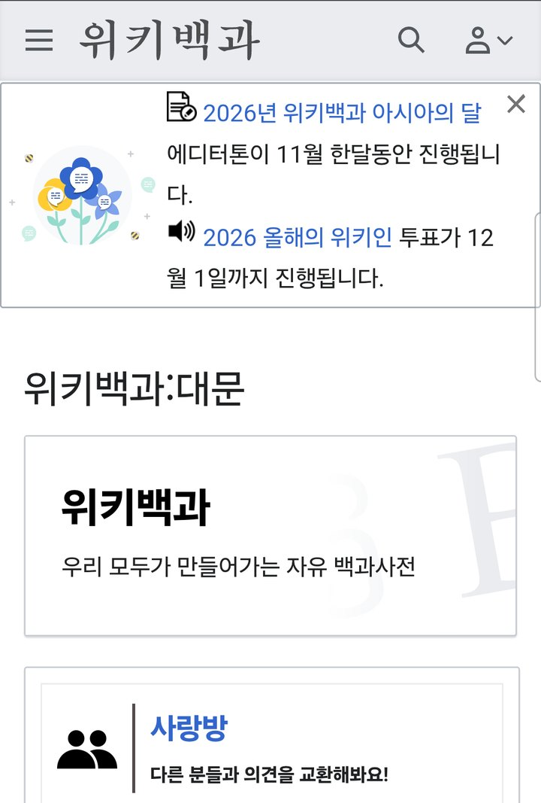
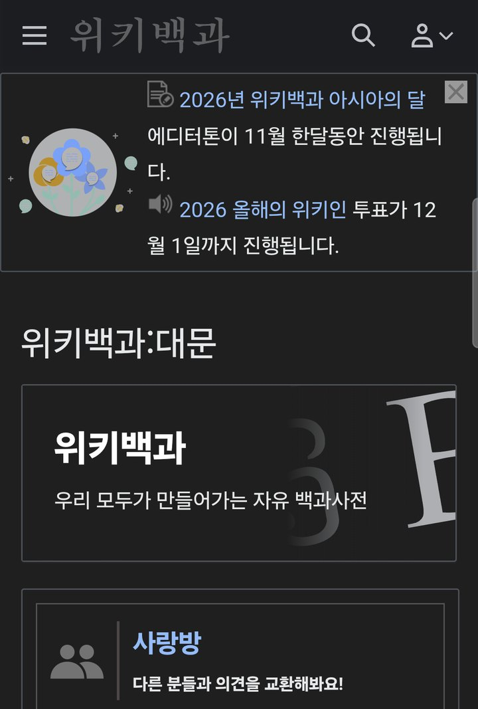

import DarkLab from '../../../components/samsungdark/DarkLab.astro';
import logo from './assets/samsung-internet-logo.png';


<p class="caption">삼성 인터넷. 출처: <a href="https://play.google.com/store/apps/details?id=com.sec.android.app.sbrowser">Google Play</a></p>

웹 프론트엔드 개발자라면 한 번쯤 겪어 봤을 겁니다. 다크 모드는 만든 적도 없는데 갤럭시에서만 화면이 시커멓게 나온다는 제보. 흰 배경은 검게, 브랜드 색 버튼은 칙칙한 갈색이 돼 있습니다. 같은 폰이라도 크롬에서는 멀쩡합니다.

범인은 삼성 인터넷의 "웹 콘텐츠에 어두운 화면 모드 강제 적용" 설정입니다. 휴대폰을 다크 모드로 쓰면 기본으로 켜지고 페이지가 다크 모드를 지원하든 말든 브라우저가 알아서 색을 바꿔 버립니다. 같은 폰에서 위키백과 대문을 열어 보면 이렇습니다.

<div class="gallery">
<div>


<p class="caption">크롬</p>

</div>
<div>


<p class="caption">삼성 인터넷</p>

</div>
</div>

고치려고 이것저것 넣어 봤지만 아무것도 통하지 않았습니다. 그래서 방향을 바꿔 두 가지를 파 보기로 했습니다.

1. 브라우저가 화면을 그리는 과정의 **어느 단계에서** 색이 바뀌는가
2. 어떤 **규칙으로** 바뀌는가

측정은 갤럭시 S25(SM-S931N), 삼성 인터넷 31.0.0.81(Chromium 148 기반)에서 했습니다. 시스템 다크 모드와 강제 적용은 켜고 눈 보호 필터는 껐습니다.

## 어디서 색이 바뀌나

### 재는 방법

휴대폰을 USB로 연결하면 PC에서 삼성 인터넷을 원격 디버깅할 수 있습니다. 이걸로 시험 페이지를 띄우고 자바스크립트를 실행하고 화면을 캡처했습니다.

시험 페이지는 격자입니다. 칸마다 색과 그리는 방식(배경, 글자, 테두리, SVG…)을 하나씩 정해 두고 캡처에서 각 칸 한가운데 픽셀을 읽어 원래 색과 비교했습니다. 회색 256단계를 11가지 방식으로 그리면 2,816칸이 됩니다.

한 가지 함정이 있었습니다. 삼성 인터넷의 캡처는 Display P3 색 공간으로 저장됩니다. 회색은 상관없지만 유채색은 값이 틀어지기 때문에 sRGB로 변환해서 비교했습니다. 변환 오차는 canvas에 칠한 대조군으로 확인했고 최대 4였습니다.

### 단계별로 확인하기

브라우저는 다섯 단계를 거쳐 화면을 만듭니다. 각 단계에서 색을 바꿨다면 어떤 흔적이 남을지 먼저 생각하고 그 흔적이 실제로 있는지 확인하는 식으로 하나씩 지워 나갔습니다.

<DarkLab locale="ko" variant="pipeline" />

#### 1단계 렌더 트리: 아니다

HTML과 CSS를 읽어 요소마다 최종 스타일을 정하는 단계입니다. 여기서 색을 바꾼다면 자바스크립트로 읽은 색도 바뀌어 있어야 합니다.

화면에서 까맣게 보이는 흰 배경을 `getComputedStyle`로 읽어 보니 `rgb(255, 255, 255)`가 그대로 나왔습니다. 강제 적용 중에는 페이지가 받는 신호도 라이트 모드 그대로입니다.

| 설정 | 화면 | `prefers-color-scheme` | 페이지의 다크 CSS |
|---|---|---|---|
| 강제 적용 켬 + 시스템 다크 | 강제로 어두워짐 | `light` | 적용 안 됨 |
| 강제 적용 끔 + 시스템 다크 | 정상 | `dark` | 적용됨 |
| 강제 적용 켬 + 시스템 라이트 | 정상 | `light` | 해당 없음 |

첫 줄을 보면 화면은 어두운데 페이지는 라이트 모드라고 알고 있습니다. 스타일이 정해질 때까지는 색이 그대로라는 뜻입니다.

#### 2단계 레이아웃: 아니다

요소의 위치와 크기를 계산하는 단계입니다. 색만 바꾸는 기능이 여기 관여할 이유는 없지만 혹시 크기나 위치가 달라지는지 확인했습니다.

시험 페이지의 2,816칸은 모두 놓은 자리, 놓은 크기 그대로 그려졌습니다. 같은 폰의 크롬으로 연 화면과 겹쳐 봐도 요소 위치가 어긋나지 않았습니다.

#### 3단계 페인트: 여기다

요소마다 "이 자리에 이 색으로 배경을 칠하고, 그 위에 글자를 써라" 같은 그리기 명령을 기록하는 단계입니다. 이 단계는 지금 그리는 것이 배경인지 글자인지 알고 있습니다.

똑같은 `#808080`을 그리는 방식만 바꿔 칠해 봤습니다.

| `#808080`으로 칠한 것 | 화면에 나온 값 |
|---|---|
| 배경 | 16 |
| 테두리 | 77 |
| SVG 도형 | 153 |
| 글자 | 164 |

입력은 하나인데 출력은 넷입니다. 무엇을 그리는지 아는 시점에 색을 바꾼다는 뜻이고 그 시점이 바로 페인트입니다. 뒤에서 볼 "20px 이하 박스"나 "90px 이하 아이콘" 같은 크기 규칙도 무엇을 어느 크기로 그리는지 알아야 적용할 수 있습니다.

#### 4단계 래스터: 아니다

기록된 그리기 명령을 실제 픽셀로 바꾸는 단계입니다. 여기서 무엇을 그렸는지 모른 채 색만 보고 바꾼다면 같은 회색은 항상 같은 값이 돼야 합니다.

그런데 3단계 표처럼 같은 회색이 대상마다 다른 값이 됐습니다. 특히 배경 16과 테두리 77은 둘 다 사각형을 채우는 같은 종류의 그리기라서 무엇을 그리는지 모르면 구별할 수 없습니다. 이미지도 마찬가지입니다. 같은 PNG 파일이 ``로 넣으면 0.7배, CSS 배경으로 넣으면 0.5배로 어두워졌습니다. 그리는 방식을 보고 바꾼다는 뜻이라 색은 래스터에 도착하기 전에 정해졌다고 보는 게 자연스럽습니다.

다만 뒤에서 볼 투명 아이콘 규칙은 이미지의 픽셀 내용을 들여다봅니다. 그 검사가 정확히 어느 시점에 일어나는지는 측정만으로 가릴 수 없었습니다.

#### 5단계 합성: 아니다

여러 레이어를 합쳐 화면에 내보내는 단계입니다. 여기서 화면 전체에 어두운 필터를 씌운다면 canvas도 함께 어두워져야 합니다.

canvas에 0, 128, 255를 칠해 봤더니 화면에서도 0, 128, 255 그대로였습니다. 적어도 화면 전체에 한꺼번에 씌우는 필터는 없습니다.

#### 결론

측정 결과를 가장 잘 설명하는 건 **페인트 단계**입니다. 스타일 계산은 이미 끝난 뒤라서 페이지의 자바스크립트는 원래 색만 보게 됩니다.

뒤에서 다룰 감지 실험도 같은 쪽을 가리킵니다. SVG 이미지를 화면이 아니라 canvas에 그려도 바뀐 색이 들어갑니다. 화면의 래스터나 합성을 거치지 않는 경로인데도 바뀌므로 그리는 순간에 바뀐다고 보는 게 맞습니다.

삼성 인터넷의 기반인 Chromium에도 강제 다크 기능이 있고 공개된 소스에서 같은 구조를 볼 수 있습니다. 링크는 Chromium 143 소스 기준입니다.

1. 스타일 단계의 [`SetUsedColorScheme`](https://github.com/chromium/chromium/blob/143.0.7499.192/third_party/blink/renderer/core/style/computed_style.cc#L3231)은 색을 바꾸지 않고 "이 요소는 강제 다크 대상"이라는 표시만 남깁니다.
2. 페인트 단계에서 배경, 글자, 테두리를 그리는 코드가 각자의 역할(`kBackground`, `kForeground`, `kBorder` 등)을 [`AutoDarkMode`](https://github.com/chromium/chromium/blob/143.0.7499.192/third_party/blink/renderer/core/paint/paint_auto_dark_mode.h)에 담아 넘깁니다.
3. [`GraphicsContext`](https://github.com/chromium/chromium/blob/143.0.7499.192/third_party/blink/renderer/platform/graphics/graphics_context.cc#L93)가 그리기 직전에 색을 바꿉니다.

측정 결과와 잘 맞습니다. 다만 변환 공식은 Chromium과 다릅니다. 이건 뒤에서 비교합니다.

## 어떤 규칙으로 바뀌나

### 1. 색상 변환

검정부터 흰색까지 회색 256단계를 대상별로 칠해 보는 것부터 시작했습니다. 아래는 RGB 색 공간을 큐브로 만들어 대상별로 나란히 놓은 것입니다. 큐브를 흰색과 검정을 잇는 축 방향에서 보면 정육각형이 됩니다. 드래그하면 모든 큐브가 같이 돌아가고 색을 누르면 대상마다 어떤 색이 되는지 나옵니다. 아래 띠는 회색 256단계를 실제 기기에서 잰 값입니다.

<DarkLab locale="ko" variant="cube" />

| 그리는 대상 | `#000000` | `#808080` | `#FFFFFF` |
|---|---|---|---|
| 일반 배경 | 1 | 16 | 31 |
| `input`, `textarea` 배경 | 17 | 29 | 42 |
| `button`, `select` 배경 | 38 | 56 | 74 |
| 그라디언트 | 5 | 18 | 31 |
| 외곽선 | 36 | 43 | 51 |
| 테두리 | 69 | 77 | 84 |
| 그림자 | 71 | 78 | 84 |
| SVG | 128 | 153 | 179 |
| 글자 | 255 | 164 | 255 |
| `` 비트맵 | 0 | 90 | 178 |
| CSS 배경 이미지 | 0 | 64 | 128 |
| canvas | 0 | 128 | 255 |

여기서 눈에 띈 것이 셋입니다.

**배경은 무슨 색이든 밝기가 1~31 안으로 눌립니다.** 흰색과 연회색이 거의 구별되지 않는 이유입니다. 색을 미리 바꿔 넣어 보정할 수도 없습니다. 페이지 전체를 칠하는 배경은 더 어둡습니다. `<html>`의 배경, 그리고 `<html>`에 배경이 없을 때의 `<body>` 배경은 흰색이 20이 됩니다. 배경을 아예 지정하지 않은 페이지는 1로 칠해집니다.

**글자는 216과 217 사이에서 끊깁니다.** 216까지는 밝기를 뒤집어서 102가 되는데, 217부터는 뒤집지 않아서 228이 됩니다. 입력은 1 차이인데 출력은 126 차이입니다.

**20px 이하의 작은 박스는 배경도 글자처럼 뒤집힙니다.** 가로세로가 모두 20px 이하이면 `#808080` 배경이 164가 되고 한쪽이라도 21px 이상이면 16이 됩니다. 작은 아이콘이나 색상 칩을 글자처럼 다루려는 것으로 보입니다.

숫자를 늘어놓고 보니 공식이 있을 것 같았습니다. 찾아보니 Daniel Aleksandersen이 2020년에 [삼성 인터넷 11을 분석한 글](https://www.ctrl.blog/entry/samsung-internet-night-mode/)에 공식이 나와 있었습니다. 색을 Y′CbCr(BT.601)로 바꾼 뒤 밝기 Y만 대상별 범위로 옮기는 방식입니다. 원래 글에서는 밝기가 85% 이상이면 변환을 건너뛰는데, 31.0에서 재 보니 흰 배경도 31로 바뀌었습니다. 실측에 맞추려면 0.85를 "뒤집을지 말지"에만 걸어야 했고, 아래는 그렇게 고친 공식입니다.

```
m  = (invert && y < 0.85) ? 1 - y : y
y' = min + m × (max - min)
```

글자가 216과 217 사이에서 끊기는 것도 이 `0.85` 때문입니다. 공식의 뼈대는 6년 전과 같았고 범위는 일부 달라져 있었습니다.

| 대상 | 2020년 (11) | 실측 (31.0) |
|---|---|---|
| 일반 배경 | 0.03 ~ 0.12 | **0.004 ~ 0.12** |
| 페이지 전체 배경 | 0.03 ~ 0.08 | **0.004 ~ 0.08** |
| `input`, `textarea` 배경 | 0.15 ~ 0.29 | **0.067 ~ 0.165** |
| SVG | 0.30 고정 | **0.50 ~ 0.70** |
| `button`, `select` 배경 | 0.15 ~ 0.29 | 같음 |
| 그라디언트 | 0.02 ~ 0.12 | 같음 |
| 테두리 | 0.27 ~ 0.33 | 같음 |
| 외곽선 | 0.14 ~ 0.20 | 같음 |
| 그림자 | 0.28 ~ 0.33 | 같음 |
| 글자 (뒤집기) | 0.29 ~ 1.00 | 같음 |

새 범위로 계산한 값은 회색 2,816개(11가지 대상 × 256단계) 측정값과 모두 ±1 안에서 맞았습니다. 유채색 72가지를 배경, 버튼, 글자, 테두리, 그라디언트, SVG로 그린 432칸 중 431칸은 채널당 3 이내였습니다.

노란 버튼이 갈색이 된 이유도 이걸로 설명됩니다. 밝기만 옮기고 색차(Cb, Cr)를 그대로 두면, RGB 세 채널에 같은 값을 더하는 것과 같습니다. `#FEE500`을 배경으로 그리면 이렇게 됩니다.

```
원래 밝기  Y  = 0.299×254 + 0.587×229 + 0.114×0 = 210.4
바뀐 밝기  Y' = (0.004 + 0.825 × 0.116) × 255   =  25.4
더할 값       = 25.4 - 210.4                    = -185.0

R 254 - 185 = 69
G 229 - 185 = 44
B   0 - 185 = 0 (음수라 0으로 잘림)
```

실측값도 정확히 `69, 44, 0`이었습니다. 밝기만 확 내린 노란색이 갈색입니다. 다만 B처럼 0 아래로 내려간 채널은 잘리기 때문에 색이 조금 틀어지고, 결과의 실제 밝기도 목표치 25보다 높은 약 46이 됩니다. 주황색 `#FF5714`는 G까지 잘려서 어두운 빨강 `142, 0, 0`이 됩니다.

### 2. 태그별 색상 변환

시맨틱 태그를 쓰면 다르게 취급할까 싶어서 태그 27종에 같은 색을 넣어 봤습니다. 결과는 세 묶음이었습니다.

| 배경색 | 일반 태그 23종 | `input`, `textarea` | `button`, `select` |
|---|---|---|---|
| `#000000` | 1, 1, 1 | 17, 17, 17 | 38, 38, 38 |
| `#808080` | 16, 16, 16 | 29, 29, 29 | 56, 56, 56 |
| `#FFFFFF` | 31, 31, 31 | 42, 42, 42 | 74, 74, 74 |
| `#FEE500` | 69, 44, 0 | 81, 56, 0 | 111, 86, 1 |
| `#FF5714` | 142, 0, 0 | 155, 0, 0 | 182, 13, 1 |
| `#1A73E8` | 0, 26, 143 | 0, 40, 157 | 0, 66, 183 |

일반 태그는 `div`, `p`, `span`, `a`, `h1`, `section`, `article`, `header`, `nav`, `footer`, `main`, `aside`, `ul`, `li`, `table`, `label`, `mark`, `code`, `pre`, `blockquote`, `fieldset`, `details`, `summary`입니다. `article`이든 `div`든 값이 완전히 같습니다. 폼 컨트롤만 따로 취급해서 같은 노란색이어도 `div`로 만든 버튼과 `button` 태그의 색이 다릅니다.

글자색은 태그와 상관없이 전부 같았습니다.

| 글자색 | 결과 |
|---|---|
| `#000000` | 255, 255, 255 |
| `#808080` | 164, 164, 164 |
| `#FFFFFF` | 255, 255, 255 |
| `#FEE500` | 149, 124, 0 |
| `#FF5714` | 255, 120, 53 |
| `#1A73E8` | 107, 196, 255 |

### 3. 이미지와 SVG

PNG, JPG, WebP끼리는 차이가 없었습니다. 어떻게 넣느냐가 결과를 가릅니다.

| 넣는 방법 | `#000000` | `#808080` | `#FFFFFF` | 규칙 |
|---|---|---|---|---|
| `` PNG, JPG, WebP | 0 | 90 | 178 | 모든 채널 × 약 0.7 |
| CSS `background-image` 비트맵 | 0 | 64 | 128 | 모든 채널 × 약 0.5 |
| `` SVG, 인라인 `<svg>` | 128 | 153 | 179 | 밝기를 0.50~0.70으로 |
| `<canvas>` | 0 | 128 | 255 | 그대로 |

``의 0.7배는 24px과 112px에서 같았고 CSS 배경의 0.5배는 반복, 늘이기, `cover`에서 모두 같았습니다. 실제 사진은 재지 않았습니다.

SVG는 비트맵과 달리 검정이 128까지 밝아집니다. 벡터는 브라우저가 직접 그리는 도형이라 색 변환을 그대로 받습니다. 그런데 크기를 바꿔 가며 재 보니 범위가 SVG 전체가 아니라 **도형 하나하나의 크기**로 정해졌습니다.

| 도형 크기 | `#000000` | `#808080` | `#FFFFFF` | 규칙 |
|---|---|---|---|---|
| 가로세로 모두 20px 미만 | **179** | 153 | 179 | 밝기를 뒤집어 0.50~0.70으로 |
| 그 밖의 도형 | 128 | 153 | 179 | 밝기를 0.50~0.70으로 |
| 한 변이 90px 이상인 `rect`, `circle`, `ellipse` | **38** | 56 | 74 | 버튼과 같은 0.15~0.29 |

19px 도형은 뒤집히고 20px 도형은 뒤집히지 않았습니다. 20px까지 뒤집히는 박스와 달리 SVG 도형은 20px이 포함되지 않습니다. 큰 도형 규칙은 `rect`, `circle`, `ellipse`에만 해당하고 같은 크기의 사각형도 `<path>`로 그리면 128로 남았습니다.

투명 PNG 아이콘에도 따로 규칙이 있었습니다. 검은 아이콘이 90px까지는 115로 밝아지다가 91px부터는 그냥 검정이 됩니다.

| 아이콘 색 | 90px까지 | 91px부터 |
|---|---|---|
| 검정 | **115** | 0 |
| 흰색 | 178 | 178 |
| 파랑 `#1A73E8` | 21, 80, 162 | 21, 80, 162 |

조건을 하나씩 바꿔 보니 세 가지를 모두 만족해야 아이콘으로 쳤습니다.

- 화면에 그려지는 크기가 가로세로 모두 90px 이하입니다. 원본 파일 크기는 상관없습니다.
- 불투명한 픽셀이 79% 이하입니다. 바탕이 꽉 찬 이미지는 해당하지 않습니다.
- 보이는 픽셀이 모두 어둡습니다. 회색 계열은 밝기 약 0.5 미만, 유채색은 약 0.29 미만이어야 하고 밝은 픽셀이 하나라도 섞이면 일반 이미지로 처리합니다.

경곗값은 조건을 조금씩 바꾼 시험 이미지로 좁혀 찾은 근삿값입니다. 아이콘으로 판정되면 모든 채널에 115를 더합니다. 어두운 배경에 묻히지 않게 작은 검정 아이콘을 밝혀 주는 규칙으로 보입니다.

### 4. Chromium의 강제 다크와 비교

삼성 인터넷은 Chromium 기반이지만 변환 공식은 다릅니다. 데스크톱 Chrome 157의 자동 다크 모드(`--enable-features=WebContentsForceDark`)를 켜고 같은 페이지를 재 봤습니다.

| 항목 | 삼성 인터넷 31.0 | Chrome 157 |
|---|---|---|
| 색 공간 | Y′CbCr | CIELAB |
| 글자 회색 102 | 183 | 163 |
| 글자 회색 204 | 110 | 204 (그대로) |
| 배경 회색 153 | 19 | 153 (그대로) |
| 배경 `#FEE500` | 69, 44, 0 | 62, 47, 0 |

Chromium은 [밝기 기준](https://github.com/chromium/chromium/blob/143.0.7499.192/third_party/blink/renderer/platform/graphics/dark_mode_settings_builder.cc#L30)을 먼저 봅니다. 배경은 밝기 205를 넘을 때만, 글자는 150 미만일 때만 뒤집고 나머지는 원래 색으로 둡니다. 삼성은 모든 배경을 눌러 버립니다. 원하는 색을 넣어 비교해 볼 수 있습니다.

<DarkLab locale="ko" variant="probe" />

Chromium 열은 Blink 코드를 옮긴 것으로, Chrome 157에서 역할과 색을 조합한 91개 지점을 재서 모두 채널당 1 이내로 맞는 것을 확인했습니다.

### 규칙을 합쳐 보면

지금까지 찾은 규칙을 일반 브라우저에서 흉내 낸 화면입니다. 위쪽 버튼으로 방식을 바꾸고 요소를 누르면 색이 어떻게 바뀌었는지 나옵니다.

<DarkLab locale="ko" variant="lab" />

노란 버튼은 갈색이 되고 카드 테두리는 배경보다 밝아지고 canvas 그래프만 혼자 하얗게 남습니다. "CSS 반전"은 흔히 쓰는 `filter: invert(1) hue-rotate(180deg)`인데, 사진까지 뒤집혀서 결과가 전혀 다릅니다. 강제 다크가 켜진 갤럭시에서 이 글을 열면 데모는 원본을 보여 주고 그 화면이 진짜 삼성 인터넷의 결과입니다.

## 우리가 할 수 있는 것

없습니다.

해 본 것들입니다. 전부 효과가 없었습니다.

- `<meta name="color-scheme" content="only light">`와 CSS `color-scheme: only light`
- `forced-color-adjust: none`
- `prefers-color-scheme: dark`용 CSS를 따로 만들어 두기 (강제 적용 중에는 `light`로 보고되니 적용되지 않습니다)
- 어두운 색을 미리 넣어 두기 (어두운 배경도 다시 변환됩니다)

삼성 인터넷 30.0에서는 `internet://flags`의 `#enable-adaptive-force-dark`를 켜면 `color-scheme` 선언을 존중하긴 했습니다(31.0에서는 다시 확인하지 않았습니다). 하지만 기본값이 꺼짐이라 사용자에게는 의미가 없습니다. Chrome은 `color-scheme: only light`만으로 강제 다크를 해제하는데, 삼성은 이걸 무시합니다.

### 대신 감지는 됩니다

`prefers-color-scheme`, `forced-colors`, `getComputedStyle`, `Sec-CH-Prefers-Color-Scheme` 헤더 모두 강제 다크를 알려 주지 않았습니다. 통한 방법은 하나였습니다. **흰색 SVG 이미지를 canvas에 그린 다음 픽셀을 읽는 것**입니다. 아래는 핵심만 남긴 코드이고, 라이브러리 버전은 상태를 더 자세히 돌려줍니다.

```ts
const svg = '<svg xmlns="http://www.w3.org/2000/svg" width="1" height="1">'
  + '<rect width="1" height="1" fill="#fff"/></svg>';

export function detectForcedDark(): Promise<boolean> {
  if (!/SamsungBrowser/i.test(navigator.userAgent)) return Promise.resolve(false);
  return new Promise((resolve) => {
    const image = new Image();
    image.onload = () => {
      try {
        const canvas = document.createElement('canvas');
        canvas.width = canvas.height = 1;
        const context = canvas.getContext('2d');
        if (!context) return resolve(false);
        context.drawImage(image, 0, 0, 1, 1);
        resolve(context.getImageData(0, 0, 1, 1).data[0] < 250);
      } catch {
        resolve(false);
      }
    };
    image.onerror = () => resolve(false);
    image.src = 'data:image/svg+xml,' + encodeURIComponent(svg);
  });
}
```

지금 보고 있는 브라우저도 검사해 볼 수 있습니다.

<DarkLab locale="ko" variant="mine" />

포맷별로 canvas에 그려서 읽어 보면 SVG만 값이 바뀝니다.

| 원본 색 (10px 이미지) | SVG | PNG | JPG | WebP |
|---|---|---|---|---|
| 흰색 | **179** | 255 | 255 | 255 |
| 회색 128 | **153** | 128 | 128 | 128 |
| 검정 | **179** | 0 | 0 | 0 |

PNG, JPG, WebP는 픽셀이 이미 정해진 파일이라 canvas로 읽으면 원본이 나옵니다. SVG는 그릴 때마다 도형을 새로 페인트하는데, 그 페인트에 강제 다크가 끼어든 결과가 canvas에 그대로 들어갑니다. 앞에서 찾은 "페인트 단계에서 바뀐다"가 여기서도 맞아떨어집니다. 179는 SVG 밝기 범위의 최댓값 0.70에 255를 곱한 값입니다. 흰색은 밝기가 0.85를 넘어 뒤집히지 않고 그대로 최댓값이 되고, 검정은 10px 이미지 안의 도형이 20px 미만이라 뒤집혀서 역시 최댓값이 됩니다.

Chromium에서는 이 값이 255입니다. canvas의 `drawImage`가 [다크 모드를 끈 기본 옵션](https://github.com/chromium/chromium/blob/143.0.7499.192/third_party/blink/renderer/modules/canvas/canvas2d/canvas_2d_recorder_context.cc#L2366)으로 이미지를 그리기 때문입니다.

감지한 다음에 할 수 있는 건 안내입니다. "메뉴(≡) → 밝게 보기"를 누르면 강제 적용이 꺼지니, 화면이 이상하면 이 버튼을 눌러 달라고 띄우는 정도입니다. 삼성 인터넷 29 이하와 "어두운 화면 모드에서 웹페이지 밝기" 슬라이더를 바꾼 경우는 확인하지 못했습니다. 강제 적용을 끈 실기기에서 255가 나오는지도 직접 재지는 않았고 삼성이 업데이트로 동작을 바꾸면 감지가 안 될 수 있습니다. 그래도 안내가 안 뜰 뿐이지 화면이 더 망가지지는 않습니다.

결국 할 수 있는 건 색으로만 의미를 전달하지 않는 것 정도입니다. 브랜드 색은 어차피 바뀝니다. 버튼은 글자와 형태만으로도 알아볼 수 있게 만들어 두는 수밖에 없습니다.

## 만들어 본 것

막을 수 없다면 적어도 갤럭시 없이 미리 볼 수는 있어야 해서 위에서 찾은 규칙으로 몇 가지를 만들어 봤습니다. 전부 한 저장소에 있습니다.

**저장소: [github.com/GUMBOKIM/samsung-forced-dark-mode](https://github.com/GUMBOKIM/samsung-forced-dark-mode)**

1. **강제 다크 감지 (`detect`)**: 앞에서 본 SVG → canvas 방법으로 지금 페이지에 강제 다크가 걸렸는지 알려 줍니다. 결과는 `forced`, `not-forced`, `not-samsung`, `unknown` 네 가지입니다.
2. **강제 다크 재현 (`emulate`)**: 일반 브라우저에서 페이지를 삼성 인터넷처럼 바꿉니다. 페이지는 페인트 단계를 건드릴 수 없으니 요소마다 역할(배경, 버튼, 글자, 테두리…)을 붙이고 계산한 색을 인라인 스타일로 덮어씁니다. SVG는 도형마다 크기를 재고 비트맵은 픽셀을 읽어 아이콘인지 판별합니다. 페이지가 바뀌면 다시 변환합니다.
3. **바로 쓰는 버전들**: ES 모듈, 복사해서 쓰는 TypeScript 단일 파일, `<script>` 태그 한 줄로 적용되는 파일, 북마크릿을 같이 만들었습니다. 런타임 의존성은 없습니다.
4. **크롬 확장 프로그램 "Forced Dark Preview for Samsung Internet"**: 툴바 버튼을 누르면 지금 보는 페이지가 삼성 인터넷처럼 바뀝니다. 확장은 다른 사이트의 이미지도 받아 올 수 있어서 페이지 안 스크립트로는 읽을 수 없는 외부 아이콘과 SVG까지 변환합니다. [크롬 웹 스토어](https://chromewebstore.google.com/detail/forced-dark-preview-for-s/oehfkkpeilbfcfdaoehhmmicdnmpahhf)에서 설치할 수 있습니다.
5. **비교 측정 도구**: 폰을 USB로 연결해 같은 페이지를 삼성 인터넷과 크롬(라이브러리 적용)으로 열고 캡처를 픽셀 단위로 비교합니다. 페이지를 이미지·CSS까지 통째로 복사해 고정하는 스크립트도 들어 있습니다. 아래 일치율은 이걸로 쟀습니다.
6. **이 글의 데모들**: 위의 큐브, 색 비교, 샘플 화면, 감지 검사가 같은 규칙으로 동작합니다.

갤럭시의 삼성 인터넷 화면과 이 라이브러리를 돌린 크롬 화면을 픽셀 단위로 비교했습니다. 채널별 오차가 10 이내면 일치로 셌습니다.

| 비교 대상 | 일치율 |
|---|---|
| 요소 종류와 색을 조합한 테스트 285칸 | 277칸 (97.2%) |
| BBC, CNN, 네이버 뉴스, 아마존 등 기사·상품 페이지 13곳 | 평균 97.2%, 최저 78.3% |

기사 페이지는 광고나 배너가 바뀌지 않도록 이미지와 CSS까지 복사해 고정한 뒤 비교했습니다. 그래서 스크립트 동작, iframe, 동영상, canvas는 비교에 들어가지 않았고, 복사하지 않은 실제 사이트에서는 일치율이 더 낮을 수 있습니다. 크롬 자동 다크 모드는 방식이 달라서 삼성 화면을 미리 보는 용도로는 쓸 수 없습니다. `:hover`, `:focus`처럼 상태에 따라 바뀌는 색은 아직 반영하지 못합니다.

## 참고 자료

- [Everything you need to know about Night mode in Samsung Internet](https://www.ctrl.blog/entry/samsung-internet-night-mode/), Daniel Aleksandersen
- [Samsung Internet's dark mode turned my orange buttons dark red](https://dev.to/burthcer/samsung-internets-dark-mode-turned-my-orange-buttons-dark-red-my-fix-is-only-partial-4f3k), Dev Bhamaria
- [Fighting Samsung's Force Dark Mode](https://matt.sibson.link/blog/samsung-dark-mode), Matt Sibson
- [Chromium Blink의 dark_mode_filter.cc](https://github.com/chromium/chromium/blob/143.0.7499.192/third_party/blink/renderer/platform/graphics/dark_mode_filter.cc)
