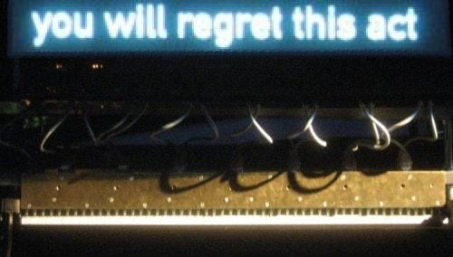
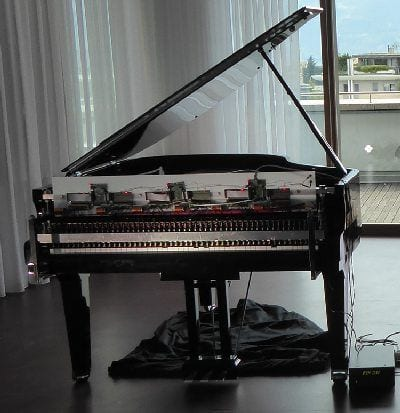
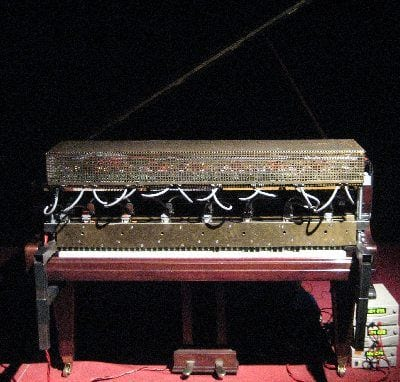

import TalkingPiano from '../../../components/talkingpiano/TalkingPiano.astro';
import pipelineFig from './assets/pipeline-en.png';
import windowsFig from './assets/windows-en.png';
import peaksFig from './assets/peaks-en.png';
import restsFig from './assets/rests-en.png';

The second entry in the [series where I build useless things](/en/posts/useless-ui/). This time the piano talks. I rebuilt the Austrian composer Peter Ablinger's "speaking piano" in the browser and fed it a few famous movie and anime lines.

## The speaking piano

A speaking piano replays a recording of someone talking on a piano. The recording is cut into slices, around 16 a second, and for each slice you work out which pitches sounded and how loud, then strike the matching piano keys that hard. No human can play that fast, so a machine does it.

Heard on its own it's contemporary music, chords pouring out. Put the sentence on a screen and the same sound suddenly turns into speech. Your brain starts finding vowels and intonation in the piano, and once you hear it you can't unhear it. Ablinger put it this way in an interview: "with a little practice, or help or subtitling, we actually can hear a human voice in a piano sound."


<p class="caption">While the machine plays, the sentence appears on the screen above. Without it, the piano doesn't talk.<br />Source: <a href="https://ablinger.mur.at/speaking_piano.html">Peter Ablinger</a></p>

Ablinger started a series called *Quadraturen* in the late 1990s. A recording is cut into a grid of time and frequency, and each cell is played back on an instrument so the original sound reappears. He called it "phonorealism", after photorealism in painting. He died in Berlin in April 2025.

The best-known piece is *Deus Cantando* (2009). A Berlin schoolboy reads the declaration of an international environmental criminal court, and the recording is moved onto a piano. The playing is done by a machine built by Winfried Ritsch, which sits on top of the keyboard and presses the keys with 88 electromagnetic fingers.

<div class="gallery">
<div>


<p class="caption">Rhea, the third-generation player, in use since 2010.<br />Source: <a href="https://ablinger.mur.at/docu11.html">Peter Ablinger</a></p>

</div>
<div>


<p class="caption">Millitron, the second generation. Both were built by Winfried Ritsch.<br />Source: <a href="https://ablinger.mur.at/docu11.html">Peter Ablinger</a></p>

</div>
</div>

The grid runs at about 16 cells per second, roughly as fast as the machine can repeat a key. A browser piano has no such limit, so the widget defaults to 40 chords a second with up to 40 keys each.

## Try it

<TalkingPiano locale="en" />

- Listen **with subtitles off** first. It sounds like a piano throwing chords around.
- Then turn **Subtitles** on and listen again. Same sound, but now it starts to sound like words. That moment is the whole point of this post.
- **Chords/s** is how many chords the piano plays per second, **Keys** is how many keys it may press at once. Lower them and you can hear where speech falls apart. At 16 chords a second you're at the limit of Ablinger's machine.

## How it works

Plain TypeScript, no libraries. The code is in the [repository](https://github.com/GUMBOKIM/gumbo-blog/tree/main/src/components/talkingpiano). A voice goes through four steps on its way to a piano score. Here they are for Zoro's line:


① A recording is just a waveform, loudness wobbling over time. ② An FFT splits it into a spectrogram showing how strong each frequency is. The horizontal stripes are the voice's fundamental and harmonics; the bright bands above them are the resonances that decide the vowel. ③ Swap the frequency axis for the 88 piano keys and you get the **keygram**. ④ Finally, pick what the piano can actually play, so many chords a second and so many keys each, and that's the score.

### A voice on 88 keys

Key *n* sounds at `440 × 2^((n − 49) / 12)` Hz, from 27.5 Hz (A0) up to 4186 Hz (C8). Take an FFT, add up everything within a quarter tone of a key's pitch, and that's the key's energy.

The low keys are the problem. Down there, neighbouring keys are only a few hertz apart. Telling them apart needs a long FFT window, and a long window smears time and loses consonants. So the window length depends on the key:


```ts
const TIERS = [
	{ n: 4096, below: 39 }, // below C4: 5.4 Hz bins, 186 ms
	{ n: 2048, below: 51 }, // C4 – C5: 93 ms
	{ n: 1024, below: KEYS }, // above C5: 46 ms
];
```

Low keys get precise pitch, high keys get precise timing. Our ears behave in a similar way.

### Cutting it into chords

The keygram has 50 rows a second and the piano plays less often than that, so each chord covers a few rows. Within that slot each key takes its loudest value, and only the keys louder than both neighbours, the peaks of the spectrum, survive. The loudest of those get played, up to the key limit.

Keeping only peaks matters. A vowel is the voice's fundamental and its harmonics with a few resonance peaks, the **formants**, on top. "Ah" and "ee" differ mostly in where those peaks sit. Below is a single chord from the middle of Zoro's 何も.


Pick the loudest keys and you get clumps around a few big peaks, which sounds like mush. Pick only peaks and the chord follows the whole shape, from the harmonics in the bass to the resonances up top, and the ear reads that shape as a vowel.

My first version stopped there, and Zoro's line was wrong. The scene needs more than a second of silence between 何も and なかった, but the piano kept tinkling through it. Breathing and leftover background noise became the loudest peaks in an otherwise quiet slot. So I added rests: if a slot's total energy is more than 22 dB below the loudest slot in the clip, the piano plays nothing.


```ts
if (energy[c] >= loudest - gateDb) {
	// pick this slot's peaks and play them
}
// otherwise, a rest
```

The gaps between sounds turned out to matter as much as the sounds. With rests in place, Zoro's silence came back.

### The piano sound

No samples; the piano is synthesized. A note is eight sine partials. Real piano strings are stiff, so their partials run slightly sharp of whole multiples, which is approximated with `n·f·√(1 + B·n²)`. Harder hits boost the upper partials for a brighter tone, lower keys ring longer, and the damper drops when the next chord arrives. The hammer's thump is 6 ms of noise.

A three-second line comes to thousands of notes. Scheduling that many Web Audio oscillators chokes the browser, so the whole thing is drawn into a `Float32Array` and played as a single buffer. Rotating a complex number instead of calling `sin()` per sample makes the render near instant.

### Playing it to Whisper

Afterwards I wondered whether a machine could understand the piano, so I fed the piano versions to the speech recognition model Whisper. Here's what it heard in Zoro's "何も…なかった":

> 最後まで視聴してくださって本当にありがとうございます。("Thank you so much for watching to the end.")

When Whisper can't make sense of audio it makes up a YouTube outro, because that's what its training data looks like. It's stuck where a listener without subtitles is, except the listener gets the subtitles and starts hearing words, and Whisper just keeps saying goodbye.

## Wrapping up

Two takeaways. First, speech survives on surprisingly little: a few dozen piano keys will do, as long as the brain already knows what's being said. Second, like the flip-dot board, the constraints did the work. Peaks instead of everything, rests instead of constant notes, and the words came through.

More useless things to come.
