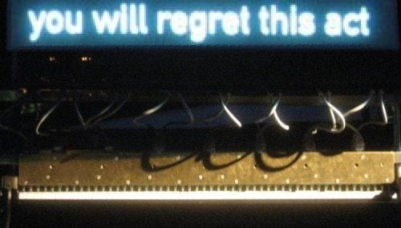
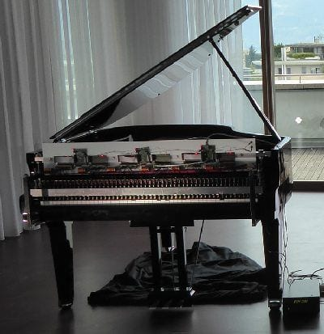
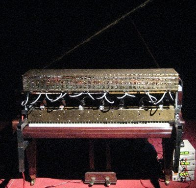

import TalkingPiano from '../../../components/talkingpiano/TalkingPiano.astro';
import pipelineFig from './assets/pipeline-ko.png';
import windowsFig from './assets/windows-ko.png';
import peaksFig from './assets/peaks-ko.png';
import restsFig from './assets/rests-ko.png';

[쓸데없는 걸 만들어 올리는 시리즈](/posts/useless-ui/)의 두 번째입니다. 이번엔 피아노가 말을 합니다. 오스트리아 작곡가 피터 아블링거(Peter Ablinger)의 "말하는 피아노"를 브라우저에 만들고, 유명한 영화·애니 대사를 넣어 봤습니다.

## 말하는 피아노

말하는 피아노는 사람 목소리 녹음을 피아노로 다시 치는 작업입니다. 녹음을 1초에 16칸 정도로 잘게 자르고, 칸마다 어떤 높이의 소리가 얼마나 세게 났는지 분석해서 그 높이에 해당하는 피아노 건반을 그 세기로 칩니다. 사람 손으로는 칠 수 없는 속도라서 기계가 칩니다.

그냥 들으면 화음이 마구 쏟아지는 현대음악입니다. 그런데 화면에 문장을 띄워 두면 같은 소리가 갑자기 말로 들립니다. 뇌가 피아노 소리에서 모음과 억양을 찾아내기 시작하고, 한번 들리면 다시 안 들리게 할 수가 없습니다. 아블링거는 인터뷰에서 "조금만 연습하거나 도움을 받거나 자막이 있으면, 피아노 소리에서 사람 목소리를 실제로 들을 수 있다"고 했습니다.


<p class="caption">기계가 피아노를 치는 동안 위 화면에 문장이 뜹니다. 이 문장이 있어야 피아노가 말을 합니다.<br />출처: <a href="https://ablinger.mur.at/speaking_piano.html">Peter Ablinger</a></p>

아블링거는 1990년대 후반부터 「Quadraturen」이라는 연작을 만들었습니다. 녹음된 소리를 시간과 주파수의 격자로 쪼갠 다음 그 칸들을 악기로 다시 연주해서 원래 소리를 재현하는 작업입니다. 본인은 이걸 사진의 포토리얼리즘에 빗대 "포노리얼리즘"(phonorealism)이라고 불렀습니다. 그는 2025년 4월 베를린에서 세상을 떠났습니다.

그중 가장 유명한 게 2009년 작품 「Deus Cantando」입니다. 베를린의 초등학생이 환경 범죄 국제 재판소 선언문을 읽은 녹음을 피아노로 옮겼습니다. 피아노를 치는 건 Winfried Ritsch가 만든 기계입니다. 건반 위에 올라앉아 전자석 손가락 88개로 건반을 누릅니다.

<div class="gallery">
<div>


<p class="caption">3세대 기계 연주자 Rhea. 2010년부터 쓰였습니다.<br />출처: <a href="https://ablinger.mur.at/docu11.html">Peter Ablinger</a></p>

</div>
<div>


<p class="caption">2세대 Millitron. 둘 다 Winfried Ritsch가 만들었습니다.<br />출처: <a href="https://ablinger.mur.at/docu11.html">Peter Ablinger</a></p>

</div>
</div>

격자의 시간 해상도는 초당 16칸 정도입니다. 기계가 같은 건반을 반복해서 칠 수 있는 한계가 그 언저리라고 합니다. 브라우저의 피아노는 그런 한계가 없어서, 위젯은 1초에 40번, 한 번에 건반 40개까지 치는 걸 기본값으로 했습니다.

## 바로 눌러 보기

<TalkingPiano locale="ko" />

- 처음엔 **자막을 끈 채로** 들어 보세요. 피아노가 화음을 마구 쏟아내는 소리로 들립니다.
- 그다음 **자막**을 켜고 다시 들어 보세요. 같은 소리인데 말로 들리기 시작합니다. 이 체험이 이 글의 전부입니다.
- **초당 타건**은 1초에 화음을 몇 번 치는지, **건반 수**는 한 번에 건반을 몇 개까지 누르는지입니다. 둘 다 줄여 보면 어디서부터 말이 무너지는지 들립니다. 초당 16번으로 낮추면 아블링거의 기계와 같은 조건이 됩니다.

## 어떻게 만들었나

전부 바닐라 TypeScript이고 라이브러리는 없습니다. 코드는 [저장소](https://github.com/GUMBOKIM/gumbo-blog/tree/main/src/components/talkingpiano)에 있습니다. 목소리는 아래 네 단계를 거쳐 피아노 악보가 됩니다. 조로 대사로 그린 그림입니다.


① 녹음은 그냥 소리의 세기가 시간에 따라 흔들리는 파형입니다. ② 이걸 FFT로 쪼개면 어떤 주파수가 얼마나 세게 났는지 보이는 스펙트로그램이 됩니다. 가로 줄무늬가 성대가 내는 기본음과 배음이고, 그 위의 밝은 띠가 모음을 결정하는 공명입니다. ③ 세로축을 주파수 대신 피아노 건반 88개로 바꾼 게 **키그램**입니다. ④ 마지막으로 피아노가 실제로 칠 수 있게 1초에 몇 번, 한 번에 몇 개만 골라 악보로 만듭니다.

### 목소리를 88건반으로

건반 하나의 주파수는 `440 × 2^((n − 49) / 12)`입니다. 가장 낮은 라(A0)가 27.5Hz이고 가장 높은 도(C8)가 4186Hz입니다. FFT로 스펙트럼을 구한 뒤 각 건반 주파수의 위아래 4분의 1음 안에 들어오는 성분을 다 더하면 그 건반의 에너지가 됩니다.

문제는 낮은 건반입니다. 저음역에서는 반음 간격이 몇 Hz밖에 안 됩니다. 이걸 구분하려면 FFT 창이 길어야 하는데, 창이 길면 시간이 뭉개져서 자음이 사라집니다. 그래서 건반 높이마다 창 길이를 다르게 씁니다.


```ts
const TIERS = [
	{ n: 4096, below: 39 }, // C4 아래: 5.4Hz 간격, 186ms
	{ n: 2048, below: 51 }, // C4 – C5: 93ms
	{ n: 1024, below: KEYS }, // C5 위: 46ms
];
```

낮은 건반은 긴 창으로 정확하게, 높은 건반은 짧은 창으로 빠르게 봅니다. 귀도 비슷하게 듣습니다. 낮은 소리에서는 음높이를 세밀하게 가리고, 높은 소리에서는 타이밍을 더 잘 잡습니다.

### 화음으로 자르기

키그램은 1초에 50줄이고 피아노는 그보다 덜 자주 칩니다. 그래서 키그램 몇 줄을 한 화음으로 묶습니다. 그 안에서 건반마다 가장 큰 값을 고르고, 양옆 건반보다 큰 건반, 즉 스펙트럼의 봉우리만 남깁니다. 그중 큰 순서로 건반 수만큼 칩니다.

봉우리만 남기는 게 중요합니다. 모음은 성대가 내는 기본음과 그 배음 위에 **포먼트**라는 공명 봉우리 몇 개가 얹힌 모양입니다. "아"와 "이"는 그 봉우리의 위치가 다를 뿐입니다. 아래 그림은 조로가 "何も"를 말하는 도중의 화음 하나입니다.


큰 순서로 고르면 큰 봉우리 몇 개 주변 건반이 뭉텅이로 뽑혀서 뿌연 덩어리가 됩니다. 봉우리만 고르면 저음의 배음부터 고음의 공명까지 모양 전체를 따라가고, 귀는 그 모양을 모음으로 알아듣습니다.

처음 만든 건 여기까지였는데 조로 대사가 이상했습니다. 何も와 なかった 사이에 1초 넘게 침묵이 있어야 그 장면인데, 그 사이에도 피아노가 작은 음을 계속 쳤습니다. 숨소리와 배경음 찌꺼기가 상대적으로 가장 큰 봉우리로 뽑힌 겁니다. 그래서 쉼표를 넣었습니다. 화음 구간 전체의 에너지가 클립에서 가장 큰 구간보다 22dB 넘게 작으면 아예 치지 않습니다.


```ts
if (energy[c] >= loudest - gateDb) {
	// 이 구간의 봉우리를 골라서 친다
}
// 아니면 쉼표
```

말을 알아듣게 해 주는 건 소리만큼이나 소리 사이의 빈틈이었습니다. 쉼표를 넣고 나서야 조로의 침묵이 살아났습니다.

### 피아노 소리

피아노 샘플 파일은 쓰지 않고 합성했습니다. 건반 하나는 사인파 8개(배음)의 합입니다. 피아노 줄은 뻣뻣해서 배음이 정수배보다 조금씩 높게 뜨는데, 그것도 `n·f·√(1 + B·n²)`로 흉내 냈습니다. 세게 칠수록 높은 배음을 키워서 밝게 만들고, 낮은 건반일수록 오래 울리게 하고, 다음 화음이 오면 댐퍼가 내려와 소리를 끊습니다. 해머가 줄을 때리는 "툭"은 6ms짜리 노이즈입니다.

3초짜리 대사 하나에 음이 수천 개입니다. 이걸 Web Audio 오실레이터로 하나하나 예약하면 브라우저가 버거워해서, 소리를 `Float32Array`에 직접 다 그린 다음 버퍼 하나로 재생합니다. 사인을 샘플마다 계산하지 않고 복소수를 회전시켜 구하니 렌더링이 순식간에 끝납니다.

### Whisper에게 들려주기

만들고 나서 혹시 기계도 알아듣나 궁금해서 피아노 버전을 음성 인식 모델 Whisper에 넣어 봤습니다. 조로의 "何も…なかった"는 이렇게 받아썼습니다.

> 最後まで視聴してくださって本当にありがとうございます。(끝까지 시청해 주셔서 정말 감사합니다)

Whisper는 소리를 못 알아들으면 유튜브 영상 끝인사를 지어냅니다. 학습한 데이터가 그렇게 생겼기 때문입니다. 자막 없는 사람과 똑같이 못 알아들은 셈인데, 사람은 자막을 보면 들리게 되고 Whisper는 끝까지 인사만 합니다.

## 마무리

이번에 배운 건 두 가지입니다. 첫째, 말소리는 생각보다 적은 정보로도 전달됩니다. 피아노 건반 몇십 개로 충분합니다. 단 뇌가 무슨 말인지 미리 알고 있을 때만입니다. 둘째, 플립닷 때처럼 이번에도 제약이 답이었습니다. 다 치는 대신 봉우리만, 계속 치는 대신 쉼표를 넣었을 때 말이 들렸습니다.

다음 글도 쓸데없는 걸 만들 예정입니다.
